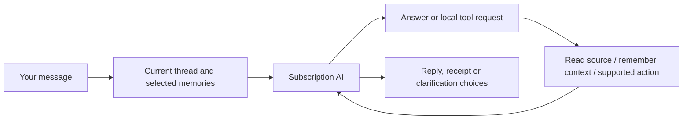

# How Mission Control works

Mission Control combines a custom dashboard with a personal assistant. Apple Calendar, Reminders and Mail remain the original sources. The assistant can retrieve information, remember useful context, suggest work and carry out supported Calendar/Reminders changes through local tools.

## The dashboard

Pages hold movable, resizable widgets. A page fits the window; content inside a widget can scroll. Pages have selectable icons. Toolbar arrangement is saved separately from widget layouts. Workspace and individual widget colours are customisable.

Current widgets include Calendar, Reminders, Mail, Today's brief, Email summary, Your PA, Tasks for you, Date & clock and Life map. Adding or viewing a widget does not itself start an AI request.

## A PA conversation

The app supplies recent conversation, relevant permitted memory and bounded source context. The AI can ask local tools for more detail. It may ask one clarification when something essential is missing, rather than requiring a rigid command phrase.

Supported Apple changes resolve exact issued record identities, check fresh revisions and verify saved results. A saved memory or an imported message cannot independently authorise a change. Mail and WhatsApp have no sending capability. Local email reply drafts can be edited, saved and copied for your own review.

A foreground turn has limits: six inference rounds, twelve tool calls, at most four Apple changes and two Mail continuations. It can report partial work rather than implying an unlimited background agent completed everything.

## Memory: what exists today

| Layer | What it contains | How it is used |
| --- | --- | --- |
| Recent conversation | Recent completed messages in the current general/topic thread | Follow-ups, references and conversational intent |
| Saved facts | Preferences, context and commitments, with account/topic ownership | Relevant recall between conversations |
| Connections and organisation | Evidence-backed subject → relationship → object links, typed endpoints and life areas | Connected recall, area notes and the Life map |
| Correction history | Original and replacement facts with separate evidence and IDs | Current recall uses the latest belief; earlier versions can be inspected/restored |
| Source records | Cached/fresh Calendar, Reminders, enabled email and selected WhatsApp text | Lookups and bounded source context; not all automatically permanent memory |

Useful facts can be learned naturally, without a remember keyword. The foreground `remember_context` tool checks the human evidence and meaning. A separate bounded learner also assesses small batches of eligible human messages when its controls and background conditions allow.

Stable directly stated facts persist until corrected or forgotten. Inferred facts are provisional; older provisional context requires review after 90 days. Resolved commitments are excluded from ordinary recall. Passing a date does not prove a task is complete.

Recall uses local word relevance, topic-area preference and up to two hops through typed connected entities, capped at 40 records and 20,000 bytes. The universal self node is excluded from expansion, so asking about one project does not pull in every fact about you. A separate bounded notebook context supplies up to four relevant areas, each with up to six source facts, within 8,000 bytes. These are useful recall layers, not a semantic embedding index or a complete biography.

There is one account-owned self identity. First-person links attach to it; an explicitly supported own-name annotation labels it. A person sharing your name remains a separate contact. Goals, habits, projects, values and personality traits have distinct types. Broad areas include About me, Studies, Career, Personal projects, Interests, Wellbeing, People, Home and Administration. Facts may belong to several areas without being copied. The current taxonomy is a starter set, rather than arbitrary nested personal folders.

The Life map widget offers Map and Notes views. Map starts from you and shows coloured area hubs; selecting an area reveals its typed entities, facts and evidence-backed relationships. Notes offers the same facts directly. Area branches are navigation, not newly inferred relationships. Empty areas are hidden, and missing notes mean unexplored context rather than proof that an activity is absent. Unclassified legacy facts stay in Not yet organised. Organisation can be edited/pinned without rewriting the fact or its original evidence.

You can inspect, correct, confirm and forget memories. A correction creates a new current version and preserves the old wording/evidence as history. Show earlier versions and Restore are available in Memory. Forgetting a current belief removes its correction lineage and suppresses relearning from its original/correction turns; a local Undo restores the removed records. Old superseded evidence is also excluded from ordinary recall and cannot be reinserted by a background learner merely paraphrasing the same quoted evidence. This is conservative history protection, not complete automatic contradiction detection.

## Topics

General has its own ongoing transcript. Each named topic has a separate transcript, focus description, optional preferred notebook area and additional scoped memory. Topic editing can choose Studies, Career or another area to bias relevant recall. All topics can still use shared PA memory; an explicit question about another area can retrieve its permitted facts. The Life map can display shared memory or shared plus one selected topic. Account/topic filtering happens before notebook projection or connected retrieval.

This is area-based focus over the same notebook, not a global alias registry or arbitrary entity-anchor focus yet. A focus choice does not broaden source permissions or expose another topic's private records.

## Questions and setup

Set up my PA opens a dedicated memory interview, separate from your normal chat and its unfinished draft. Start it explicitly, then answer one short question at a time. It builds breadth across questions, using existing shared/current-topic memory to avoid repeating what it already knows. Questions have a completed-output length/format check; a failed response offers Continue instead of pasting a long answer into the normal chat.

The interview has its own saved account/topic/session transcript and answer draft. Close pauses your interaction without deleting them; Continue memory setup reopens it. Skip moves to another question. Finish ends that interview while retaining its answers and any facts already saved; another setup starts a new interview. The interview exposes only memory tools, never Calendar/Reminders changes or source reads. Normal PA chat keeps its full task tools. New interview turns are excluded from ordinary chat/history, while real answers remain eligible for existing bounded memory learning; synthetic start/skip/continue controls are excluded. A rich answer can produce several distinct concise facts from the same turn. Confident organisation is attached in the original save, rather than requiring an administration call for every fact. Questions use the notebook's known/unexplored areas to build breadth before probing details. Existing old setup messages are preserved. Fictional subscription evaluations and live personal interview acceptance are recorded separately in STATUS.

Occasional learning questions also exist: at most one per local day, grounded in eligible human conversation and included in the existing bounded learning pass. They can be dismissed and undone. This is not yet an autonomous interview based on every source in your life.

## Queued work and handoffs

You can queue another request while the PA replies. Requests capture their account and topic and execute serially once the queue is explicitly started. Completed queued work stays in Tasks for you as a handoff.

A genuine clarification pauses advancement. A failed/stopped request also pauses it. On relaunch, unfinished running requests become interrupted and are not replayed automatically. This avoids blindly repeating a possible Apple change. Waiting requests can be continued explicitly.

Tasks for you also shows existing grounded recommendations and prepared email replies. A draft is a proposed output, not proof that every sentence is correct or that an email has been sent.

## Background work

The app has separate bounded jobs for incoming-email assessment, morning brief preparation, conversational learning, existing-memory organisation and proactive source comparison. They respect their controls, source selections, account ownership and subscription limits. They do not all run on every refresh. Ordinary source refresh/reception makes no AI calls.

Notebook organisation classifies already-saved human facts only. It preserves the original text/evidence and never scans Mail/WhatsApp or changes Apple records. Its own automatic control is default-on, additionally requiring memory and conversation learning enabled; it runs only when idle, at most two eight-fact passes per account/day with a 30-minute cooldown. A manual Organise memories action processes up to four small batches across shared/selected-topic memory. Manual pins are protected. Interrupted/failed work remains paused until explicitly resumed. These are incremental classifications, not automatic semantic merging or deletion.

Today's morning message is saved once. An explicit daytime update is separate and does not deliver another morning notification. Email monitoring prioritises relevant new mail rather than summarising a historical backlog. WhatsApp reception caches partial linked-device text locally; PA access and brief inclusion have separate selected-chat controls.

Broader source-origin memory learning, reusable non-self entity/alias identity and automatic reversible semantic consolidation are still planned. Current access does not mean every available email or WhatsApp message is automatically analysed into permanent memory. Area notes are evidence-linked projections of existing facts, not separate AI-written biographies.

## Where information lives

Code and this project notebook are in this Git repository. App records are outside Git in local application storage; preferences use the app's settings domain. Credentials use Keychain. The WhatsApp helper's session and message cache are encrypted with a Keychain-held key. This does not mean every ordinary app record is encrypted in the same way.

Selected source context is sent to subscription inference when the corresponding AI feature runs. There is no API-key billing fallback. The app needs an awake Mac for local jobs; a sleeping Mac cannot be assumed to run them on schedule. Permissions belong to Mission Control itself.

## How we know a change works

There are separate checks for compilation, signing, deterministic fixtures, process launch, actual subscription-model quality and live interface/source behaviour. The manually invoked fictional notebook evaluation checks typed identity, areas, evidence-backed recall, unknown information and natural correction intent. It also exercises the production memory-only setup tools with a disposable in-memory database. It never stores fiction in your profile or sends real sources. Some graph/setup/queue interaction checks remain pending because app control was unavailable. [STATUS](../STATUS.md) is the record of results and limits, not merely intended behaviour.

Memory tool failures now appear in **Memory tool notes** on the relevant reply or interview. Supporting quotes preserve the actual current human wording while tolerating formatting differences. Unsupported graph-link evidence can be omitted independently of a fact, but facts and retained relationships still need human-statement validation. Old failures cannot be reconstructed if their tool details were never saved.

### Learning from selected WhatsApp context

In Settings → WhatsApp → PA chat access, **Learn useful context from recent selected chats** is a separate opt-in. Reading chat tools or enabling Today’s brief does not activate it. Small recent batches run only while the app is idle and the learning controls/connection permit them. These batches share a persisted four-pass/day,30-minute-cooldown learning budget with conversation learning and notebook organisation. Interrupted jobs remain paused; Settings → Assistant → Check recent WhatsApp context resumes one bounded pass.

Source memories contain the exact quote and source identity/revision. They are always initially provisional and situational, never a user-stated preference. The source cache remains encrypted; derived facts/quotations are stored in the existing local PA memory store alongside other memories. Nothing is committed to Git. Source access, linked identity, current cached content and memory scope gate recall. Exclusion, edit or cache absence removes the affected source memory from foreground recall and the notebook; review/history records remain saved. Forget suppresses the same evidence version. A later human statement can establish independent human memory rather than being deduplicated against a provisional source guess.

These new source memories currently feed foreground chat/notebook retrieval. Automatic brief/proactive memory inputs remain human-only until those persistent artifacts also support source-memory dependency invalidation. New chat replies save conservative dependency IDs and are omitted from subsequent AI history if those source beliefs become unavailable. This does not delete the local transcript.

### Appearance and PA name

Choose **3PO** in Customise colours for coordinated light/dark gold, ivory and bronze profiles. Existing themes and individual widget overrides keep their behaviour. Use the PA’s ellipsis menu → **Name your PA…**, or Assistant settings, to choose a name. This is a local display preference, not a new thread or memory profile. The default remains Your PA. Name changes during an AI request invalidate late output.

The Life map uses a stable bilateral layout on wide widgets and a single trunk on narrow widgets. It places area cards around the owner without overlapping labels. Dotted highlighted branches mean the selected area shares a saved fact with that area; branches organise notes rather than claiming every displayed area is a new factual relationship.

The Life map widget has a compact Map/Notes switch without a search row. Its map scales uniformly to fit the available width and height; wider widgets keep the diagram centred rather than stretching branches. Click an area to browse its notes and evidence in a separate detail view. Notes can scroll; the map overview stays fully visible. Detailed organisation status is available from the saved-fact count tooltip. Memory management retains its own search.
