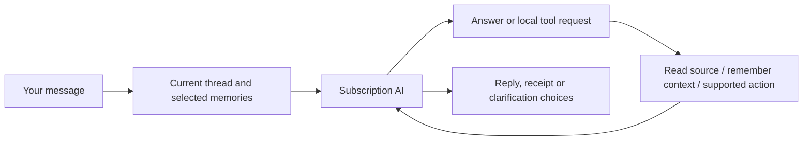

# How Mission Control works

## Compound email suggestions

Email assessment can retain up to twelve separate exact quotes for requirements, deadlines and scheduling windows. Review can show separate Calendar and project-task suggestions on the same email card, using an issued existing space and its revision. Review forms carry supported dates; project tasks retain exact timed wording in notes. Adjust with assistant adds the human variation to the visible assistant draft. Approvals recheck source evidence and use normal saved receipts; reading or suggesting never creates an item. See [implementation and acceptance](EMAIL_ACTIONS_PLAN.md).

For current component ownership and the path from a message to a verified answer, start with [Architecture](ARCHITECTURE.md). The [reliability checklist](RELIABILITY_IMPLEMENTATION.md) distinguishes implementation from completed acceptance.

The reliability candidate separates conversation execution, learning, heartbeat orchestration, source reads and keyed storage from dashboard presentation. Background stages capture an exact heartbeat run; cancellation or changed ownership rejects results before saving, while earlier completed work remains. Construction loads settings without writing fallback defaults. The installed candidate passes preservation and normal relaunch checks; sustained acceptance remains open in LIVE_ACCEPTANCE and STATUS.

## 12 October: readable reports without internal source labels

Briefs, assistant replies, Review explanations and remembered reports hide internal source aliases such as `[calendar_4]` and `[weather_0]`. Saved output gets the same local display treatment immediately, with no AI refresh or data migration. Bare references use readable source-type labels; ordinary links, Markdown, explicit code examples, human messages and original evidence quotes retain their content. **Sources and coverage** still exposes readable labels and links from unchanged structured evidence. Raw saved prose remains available for exact morning-delivery/history checks, alongside the same source IDs and receipts. Future brief/reply instructions keep aliases in structured evidence/tool fields and names in prose.

## 12 October: reasoned preferences from email feedback

Feedback on an email now uses one explicit, bounded subscription request to reason from your comment, the selected topic, and that exact email's sender, subject and up to 16,000 body characters. The **learned preference is the primary memory**, rather than a verbatim copy of an ambiguous comment. Original human words remain evidence. For example, ‘These emails aren't important’ on a general university broadcast can teach that routine newsletters from that communications team should stay quiet, while a new personal request or obligation still matters. Explicit sender-wide human wording can set a broader scope.

**Submit feedback** retains your words locally and closes the dialog immediately. The app processes explicit submissions serially in the background, waiting for other PA operations to finish. You can switch pages, including opening the assistant, while it learns. The card shows progress and the saved preference; Review preferences retains unfinished feedback even if its card leaves the inbox. A targeted Stop stops only that submission. Foreground typing/sending cancels active feedback and interrupts queued submissions, keeping their words for an explicit retry.

Review preferences and Memory expose the same canonical preference, its original feedback and email-context metadata. You can edit it directly, Disable/Restore it or inspect history. Changing the original comment/topic clears its old interpretation. Opening these panels makes no inference or source request. Interpretation reads the exact email before and after inference and rejects changed content/account/header/assessment/source controls/model/memory or foreground cancellation. Failures offer **Retry learning** and the explicit **Save only my words** fallback; there is no silent downgrade or automatic retry. Reopening retains interrupted submissions without replaying them. Pending feedback is not a recall fact. Exact issued memory IDs prevent duplication if the memory save succeeds but recording its completion fails. Inference requests one completed typed `pa.interpret_review_feedback` result through the existing subscription protocol, with no action execution or extra inference round. A plain-text preference cannot silently become a saved rule. The decoder accepts a complete JSON code fence and otherwise reports a feedback-specific format error without exposing a raw Cocoa decoding error. Dismiss remains acknowledgement only.

The interpretation stores header and exact identity/version receipts, not the email body or model reasoning. It is human-authorised policy with separately labelled inferred scope, not a new source-derived life fact. Future matching uses the reasoned preference and sender/purpose context within existing bounded local retrieval and exact memory dependencies. Sender domain suffixes alone do not seed matching. The policy survives loss of the example email; inferred unconfirmed preferences retain the existing 90-day review boundary. Changing a learned preference to another memory type retains a correction version and its evidence while removing review-only metadata. Existing preferences and histories are preserved without automatic rewriting or consolidation.

## 11 October: simpler Review and feedback in memory

Feedback's editable About field is retained as a human-confirmed topic anchor, separate from the exact feedback evidence. It gives context to words such as these/this without turning source text into a human assertion or a blanket sender rule.

Review shows outstanding actions, genuinely worthwhile reading, proposals needing approval and work needing a human answer or outcome check. An email and its supported suggestions share one card. Each card has one **Dismiss** action: acknowledgement of the displayed concern, with existing Undo. It neither completes work nor teaches disinterest. Completed suggestions and inferred addressed/planned history leave the main inbox; supported email history is inspectable under **Activity → Review history**, with **Keep in review**.

**Feedback** opens a text prompt. The 12 October change above supersedes the original local-only save: new email feedback saves a reasoned preference with the original words as evidence. Feedback without an email context remains a local preference edit and does not dismiss the item. **Review preferences** and **Memory → Overview → Review preferences** inspect the same records; edits retain original evidence and version history, and Disable/Restore controls recall. Earlier explicit topic preferences remain preserved in a separate disclosure. They are not automatically rewritten or merged.

Targeted header/body review prioritises relevant feedback within the existing bounded human-fact selection. The model applies purpose, action, stage, conditions and exceptions: a routine assessment submission receipt can stay quiet while an invitation, new stage or meaningful result from the same sender matters. New policy and changed relevant feedback reconsider already-assessed recent mail in the existing three-body batch, without resetting Mail history or resurrecting acknowledged concerns. Older informational reading judgements wait for that policy recheck before entering Review; outstanding actions, human Keep overrides and pending proposals remain eligible. Opening feedback, preferences or history uses no AI. Selected memory receipts and revision checks reject stale inference. General semantic recall/consolidation remains separate quality work.

Native handled associations require an outstanding action, exact current evidence and distinctive target qualifiers in the saved request quote, plus a model judgement that all actions are covered. Common words such as assessment cannot link coding recruitment work to a risk assessment. The guard also withholds unsupported legacy associations while retaining their stored receipts. An uncertain canonical creation claim remains visible and cannot gain another approval from an inferred match.

Mission Control combines a custom dashboard with a personal assistant. Apple Calendar, Reminders and Mail remain the original sources. The assistant can retrieve information, remember useful context, suggest work and carry out supported Calendar/Reminders changes through local tools.

## The dashboard

Pages hold movable, resizable widgets. A page fits the window; content inside a widget can scroll. Pages have selectable icons. Toolbar arrangement is saved separately from widget layouts. Workspace and individual widget colours are customisable; named colour themes can be saved locally.

The Review inbox sidebar icon and widget header show a live number of items needing your attention. It counts current questions, actionable or worthwhile-reading email cards, proposals or updates, and delegated work needing an answer or outcome check. Dismiss, Undo and Keep in review update it immediately. Already planned/addressed emails, approved proposals, verified creations and ordinary queued/running work do not inflate it. An email assessment and its background suggestions share one card and one count, while each suggestion retains its own approval and save receipt. One Dismiss acknowledges the displayed card. Zero hides the badge; above 99 displays 99+ with the full accessible count. Viewing it reads existing local projections only.

Current widgets include Calendar, Reminders, Mail, Today's brief, Email summary, Your PA, Review inbox, Date & clock and Life map. Adding or viewing a widget does not itself start an AI request.

Opening a Calendar widget returns it to today, including when switching dashboards or calendar widgets in Focused view. Day/Week also refocuses the current time, like Now. Browsing dates while the widget stays open still works; view mode and source filters are preserved.

Focused view uses plain widget names when a type appears once on the current dashboard. Multiple widgets of the same type are numbered within that type, so Reminders 4 means the fourth Reminders widget, independent of Calendar or other widgets.

Date & clock’s Adaptive face measures the localised date/time text and scales it to fill the available width and height, without a fixed maximum font size. Adaptive layout puts the date and time side by side in wide widgets; Digital and Calendar layouts are selectable from its ellipsis menu, alongside Centre/Leading alignment, clock visibility, seconds and 24-hour time. These are local per-widget preferences. Ellipsis menus use only three dots.

## A PA conversation

The app supplies recent conversation, relevant permitted memory and bounded source context. The AI can ask local tools for more detail. It may ask one clarification when something essential is missing, rather than requiring a rigid command phrase.

Supported Apple changes resolve exact issued record identities, check fresh revisions and verify saved results. A saved memory or an imported message cannot independently authorise a change. Mail and WhatsApp have no sending capability. Local email reply drafts can be edited, saved and copied for your own review.

If a Calendar/Reminders operation reaches a known local read prerequisite, 3PO performs the missing permitted read and continues the same request once. Creation checks enabled destinations; an edit/deletion reads exact details only for a target already issued in that turn. Your dates, destination, target, recurring scope and authorisation stay unchanged. Stop or changed ownership/permissions blocks the continuation. A failed read is reported accurately as preparation, with no save attempted; an uncertain native save is never automatically repeated. Successful preparation clears only its matching visible error and retains the diagnostic history. Reopening the app does not replay old failed requests.

A foreground request has no fixed count of changes, tool calls, inference rounds or Mail continuation pages. The PA continues the requested work until it finishes, needs an answer, is stopped, encounters a real failure or its captured account/settings change. Stop remains available, and verified changes keep their receipts. Repeated identical tool results stop a stalled loop. Long requests retain complete recent tool rounds and trim older completed rounds with a progress summary when the transport context needs room; stored receipts and exact issued identities remain. Per-read/payload bounds, subscription limits and independent automatic-work budgets still apply.

## Memory: what exists today

The [Memory and context guide](MEMORY_AND_CONTEXT.md) explains the record structure, recall gates and code/storage ownership. In the app, Memory now opens an Overview of saved/current/available facts; Facts, Life areas and Controls keep inspection separate from learning controls. Life map and Settings link to the same inspector. The local recall preview uses the production ranker without an AI call. New foreground replies expose Context details with prepared memory/notebook IDs, additional memory-read IDs, bounded dialogue counts, model/Focus and attempted tools; it stores no additional source bodies or old prose, and does not claim model attention or verified writes. Older replies retain their existing data without a retroactive trace.

| Layer | What it contains | How it is used |
| --- | --- | --- |
| Recent conversation | Recent completed messages in the ongoing general PA conversation (legacy thread tags stay saved) | Follow-ups, references and conversational intent |
| Saved facts | Preferences, context and commitments, with account/topic ownership | Relevant recall between conversations |
| Connections and organisation | Evidence-backed subject → relationship → object links, typed endpoints and life areas | Connected recall, area notes and the Life map |
| Correction history | Original and replacement facts with separate evidence and IDs | Current recall uses the latest belief; earlier versions can be inspected/restored |
| Source records | Cached/fresh Calendar, Reminders, enabled email and selected WhatsApp text | Lookups and bounded source context; not all automatically permanent memory |

Useful facts can be learned naturally, without a remember keyword. The foreground `remember_context` tool checks the human evidence and meaning. A separate bounded learner also assesses small batches of eligible human messages when its controls and background conditions allow.

Stable directly stated facts persist until corrected or forgotten. Inferred facts are provisional; older provisional context requires review after 90 days. Resolved commitments are excluded from ordinary recall. Passing a date does not prove a task is complete.

Recall uses local word relevance, selected life-area preference and up to two hops through typed connected entities, capped at 40 records and 20,000 bytes. Targeted checks can receive zero facts: they no longer fill spare space with unrelated memories or always pin preferences. Your supported self-name and the universal self node cannot pull in every fact about you. Email assessment/drafting uses the specific message as its retrieval subject; writing preferences are added for drafting. A separate notebook summary uses the same selected fact IDs, plus matching/linked project anchors, within 8,000 bytes. Deliberately broad day planning, setup and null-query memory tools retain bounded orientation. No saved facts are deleted by selection. These are local recall layers, not a semantic embedding index or a guarantee that every word match is relevant.

There is one account-owned self identity. First-person links attach to it; an explicitly supported own-name annotation labels it. A person sharing your name remains a separate contact. Goals, habits, projects, values and personality traits have distinct types. Broad areas include About me, Studies, Career, Personal projects, Interests, Wellbeing, People, Home and Administration. Facts may belong to several areas without being copied. The current taxonomy is a starter set, rather than arbitrary nested personal folders.

The Life map widget offers Map and Notes views. Map starts from you and shows coloured area hubs; selecting an area reveals its typed entities, facts and evidence-backed relationships. Notes offers the same facts directly. Area branches are navigation, not newly inferred relationships. Empty areas are hidden, and missing notes mean unexplored context rather than proof that an activity is absent. Unclassified legacy facts stay in Not yet organised. Organisation can be edited/pinned without rewriting the fact or its original evidence.

You can inspect, correct, confirm and forget memories. A correction creates a new current version and preserves the old wording/evidence as history. Show earlier versions and Restore are available in Memory. Forgetting a current belief removes its correction lineage and suppresses relearning from its original/correction turns; a local Undo restores the removed records. Old superseded evidence is also excluded from ordinary recall and cannot be reinserted by a background learner merely paraphrasing the same quoted evidence. This is conservative history protection, not complete automatic contradiction detection.

## Focus

The PA now uses one ongoing general conversation. Its Focus control lets you choose several life areas, such as Studies and Career, or All areas. This biases relevant recall; it does not start another chat or prevent an explicit question from using other relevant memories. The Life map has its own Focus control for displaying a subset of areas. Choices are saved per widget and account; the expanded PA view saves its account preference separately. Each new request and queued request captures the selected areas when submitted, so later changes do not retarget work already running.

Earlier named-topic transcripts, drafts, IDs and memory ownership are retained in storage without merging or deleting them. The new selector does not browse those historical transcripts. A previous topic's area preference seeds Focus until a new choice is saved. Normal Focus chat and the Life map can retrieve this account's usable earlier topic memories as part of the same notebook. New normal-chat memories are shared. Other accounts and disabled source context remain excluded; Focus grants no source access or write permission. Existing legacy queued work retains its original captured thread.

This is multi-area focus, not arbitrary entity anchors or a global alias registry. Account and source-permission filtering still precede notebook projection and connected retrieval.

## Questions and setup

Set up my PA opens a dedicated memory interview, separate from your normal chat and its unfinished draft. Start it explicitly, then answer one short question at a time. It builds breadth across questions, using this account’s existing permitted notebook memory to avoid repeating what it already knows. Questions have a completed-output length/format check; a failed response offers Continue instead of pasting a long answer into the normal chat.

The interview has its own saved account/topic/session transcript and answer draft. Close pauses your interaction without deleting them; Continue memory setup reopens it. Skip moves to another question. Finish ends that interview while retaining its answers and any facts already saved; another setup starts a new interview. The interview exposes only memory tools, never Calendar/Reminders changes or source reads. Normal PA chat keeps its full task tools. New interview turns are excluded from ordinary chat/history, while real answers remain eligible for existing bounded memory learning; synthetic start/skip/continue controls are excluded. A rich answer can produce several distinct concise facts from the same turn. Confident organisation is attached in the original save, rather than requiring an administration call for every fact. Questions use the notebook's known/unexplored areas to build breadth before probing details. Existing old setup messages are preserved. Fictional subscription evaluations and live personal interview acceptance are recorded separately in STATUS.

Occasional learning questions also exist: at most one per local day, grounded in eligible human conversation and included in the existing bounded learning pass. They now appear in Review inbox, with Answer, Dismiss and account-owned Undo. Older chat deliveries remain saved; new background questions do not enter normal chat. This is not yet an autonomous interview based on every source in your life.

## Queued work and handoffs

You can queue another request while the PA replies. Requests capture their account and current Focus and execute serially once the queue is explicitly started. Completed chat replies remain in the PA conversation; they no longer clutter Review inbox. Pending, interrupted or answer-needed work remains visible there.

A genuine clarification pauses advancement. A failed/stopped request also pauses it. On relaunch, unfinished running requests become interrupted and are not replayed automatically. This avoids blindly repeating a possible Apple change. Waiting requests can be continued explicitly.

A later submission or completion email can move an earlier request into **Addressed by later email**. It must be in the same enabled Mail account, later than the request, and clearly refer to the same action and stage while covering every requested action. The card keeps both exact source quotes and offers Original request, Open confirmation and Keep in review. Dismissing the receipt does not reopen completed email work. A new result, another assessment, an unsuccessful submission or an unfinished sibling action stays eligible. The PA and brief receive supported completion context so they do not repeat the old obligation; this does not tick off or delete Apple items.

Comparison can use up to twelve current saved confirmation assessments from the last thirty days, including quiet or dismissed receipts, alongside its bounded request pool. Header triage reads personal completion receipts for evidence without making them active tasks. Previously skipped matching incoming headers and older matching receipt assessments may be reconsidered within the existing three-message body batch; historical Mail monitoring is not restarted. Resolution records and their depended-on confirmation assessments survive normal cache pruning. Supporting request/receipt bodies remain eligible for periodic bounded rechecks. Observed body drift is saved before reassessment: failed or interrupted inference cannot leave the old evidence suppressing a request. Changed source/account/assessment/permission support withdraws the inferred resolution while preserving its history. Pending native save outcomes remain available for checking and gain no fresh approval authority.

Review inbox prioritises source-linked missing-plan suggestions, emails needing action and prepared replies. Monitored new emails can produce local drafts during their existing assessment job. Older eligible reply-needed cards offer Draft reply: one fresh read-only email-body lookup and bounded subscription request, with account, source, model and memory checks before saving. Drafts use placeholders for unknown availability or decisions; Review draft supports editing, saving and copying. Nothing is sent or written to Mail.

Suggestions compare bounded email assessments and recent selected WhatsApp text with fresh enabled Calendar/Reminders records. Existing similar plans count as coverage; partial source access is not proof that no plan exists. Each card retains an exact source quote and identity. Review suggestion opens the native event/reminder review form; only the human's explicit Create saves it. A draft or suggestion is proposed work, not proof that it is correct, complete or accepted.

Settings → WhatsApp → PA chat access → Suggest useful tasks from recent selected chats is a separate off-by-default opt-in. The existing idle proactive job may compare at most eight cached selected-chat messages from the last 48 hours. There is no daily output cap; automatic request allowances and cooldowns still bound inference. Tasks refresh can request one comparison of currently shared chats even when automatic inclusion is off. Foreground chat access alone does not enable this background work. Access revocation, linked identity changes, edits and cache absence hide dependent WhatsApp suggestions and refuse stale native saves. Source refresh/reception still makes no AI request.

## Background work

The heartbeat coordinates incoming-email assessment, proactive source comparison and automatic brief preparation under its persisted request allowance. Conversational/source learning and existing-memory organisation retain separate controls and recovery rules. All jobs respect source selections, account ownership and subscription limits; ordinary source refresh/reception makes no AI calls. There is no independent morning inference timer.

Notebook organisation classifies already-saved human facts only. It preserves the original text/evidence and never scans Mail/WhatsApp or changes Apple records. Its own automatic control is default-on, additionally requiring memory and conversation learning enabled; it runs only when idle, at most two eight-fact passes per account/day with a 30-minute cooldown. A manual Organise memories action from Focus processes up to four small batches across this account’s shared and earlier-topic human memory. Manual pins are protected. Interrupted/failed work remains paused until explicitly resumed. These are incremental classifications, not automatic semantic merging or deletion.

Today's original daily message is saved once. Heartbeats and explicit updates refresh the widget separately. New briefs greet you for the local time and focus on the remaining day; the original delivery stays saved. Email monitoring prioritises relevant new mail rather than summarising a historical backlog. WhatsApp reception caches partial linked-device text locally; PA access and brief inclusion have separate selected-chat controls.

Bounded separately opted-in WhatsApp/Calendar/Reminders/Mail source learning is implemented. Broader source coverage, reusable non-self entity/alias identity and automatic reversible semantic consolidation remain planned. Current access does not mean every available email or WhatsApp message is automatically analysed into permanent memory. Area notes are evidence-linked projections of existing facts, not separate AI-written biographies.

## Where information lives

Code and this project notebook are in this Git repository. App records are outside Git in local application storage; preferences use the app's settings domain. Credentials use Keychain. The WhatsApp helper's session and message cache are encrypted with a Keychain-held key. This does not mean every ordinary app record is encrypted in the same way.

Selected source context is sent to subscription inference when the corresponding AI feature runs. There is no API-key billing fallback. The app needs an awake Mac for local jobs; a sleeping Mac cannot be assumed to run them on schedule. Permissions belong to Mission Control itself.

## How we know a change works

For the concise memory model, see [Memory and context](MEMORY_AND_CONTEXT.md): collect, remember, connect, recall, maintain. Current human context can be retired/restored locally without deleting evidence or projects. Saved project bindings now participate in recall across renames/corrections, and unpinned human-fact classifications can be reconsidered after 30 days within the existing learning allowance. This does not enable broader source learning or automatic semantic deletion/consolidation.

There are separate checks for compilation, signing, deterministic fixtures, process launch, actual subscription-model quality and live interface/source behaviour. The manually invoked fictional notebook evaluation checks typed identity, areas, evidence-backed recall, unknown information and natural correction intent. It also exercises the production memory-only setup tools with a disposable in-memory database. It never stores fiction in your profile or sends real sources. Some graph/setup/queue interaction checks remain pending because app control was unavailable. [STATUS](../STATUS.md) is the record of results and limits, not merely intended behaviour.

Memory tool failures now appear in **Memory tool notes** on the relevant reply or interview. Supporting quotes preserve the actual current human wording while tolerating formatting differences. Unsupported graph-link evidence can be omitted independently of a fact, but facts and retained relationships still need human-statement validation. Old failures cannot be reconstructed if their tool details were never saved.

### Learning from selected WhatsApp context

In Settings → WhatsApp → PA chat access, **Learn useful context from recent selected chats** is a separate opt-in. Reading chat tools or enabling Today’s brief does not activate it. Small recent batches run only while the app is idle and the learning controls/connection permit them. These batches share a persisted four-pass/day,30-minute-cooldown learning budget with conversation learning and notebook organisation. Interrupted jobs remain paused; Settings → Assistant → Check recent WhatsApp context resumes one bounded pass.

Source memories contain the exact quote and source identity/revision. They are always initially provisional and situational, never a user-stated preference. The source cache remains encrypted; derived facts/quotations are stored in the existing local PA memory store alongside other memories. Nothing is committed to Git. Source access, linked identity, current cached content and memory scope gate recall. Exclusion, edit or cache absence removes the affected source memory from foreground recall and the notebook; review/history records remain saved. Forget suppresses the same evidence version. A later human statement can establish independent human memory rather than being deduplicated against a provisional source guess.

A source pass assesses at most eight waiting versions. It can also supply bounded same-chat neighbours/latest reports and quotations from up to eight relevant current provisional source memories, within the same 12 KB message/24 KB total input limits. At most 24 recent messages are supplied in all; context-only messages do not advance the assessment cursor or become primary facts. Saved quotations may supply older context without a historical scan. The input labels this as partial history; absence is unknown.

A later report can update an issued provisional source belief from that same WhatsApp conversation. The new version preserves the old wording/evidence and retains the earlier primary quote as support, even if the model omits it. It needs a newer source timestamp, exact current evidence and captured ownership. Up to three exact quotations can support one belief; every cited version must still be available and permitted for recall. Reports can be labelled proposed, accepted, changed, cancelled or completed. These are attributed source states, never confirmation that an Apple reminder is complete. Human-confirmed facts, human-origin facts and manually pinned records cannot be replaced by this background path. Same-named unrelated chats are separate; cross-email/WhatsApp identity matching is not implemented here. Ambiguous linkage should be omitted, not guessed.

Facts and opaque per-message assessment receipts save together. Receipts include account, linked identity and exact content version in their hash, retain up to seven days/4,000 entries, and include valid assessments that save no facts. If the separate coverage cursor fails to save, explicit recovery uses the receipt instead of requesting another paraphrase. Failed/interrupted jobs still await manual resume; receipt recovery does not automatically unpause them. Forgetting a historical quote also excludes surviving source beliefs that cite it; the quotations are hidden on those affected Memory cards. Undo restores the removed source versions and their dependent recall. Separate Forget operations retain their own evidence suppression, so undoing one cannot undo another; earlier unowned suppression is preserved. A revoked/missing current version never automatically reactivates an earlier plan. This is a bounded versioning foundation, not complete semantic contradiction detection or cross-source commitment tracking.

These source memories feed foreground chat/notebook retrieval and, from the 7 October advice increment, permitted automatic brief/proactive inputs with persistent dependency invalidation. New chat replies save conservative dependency IDs and are omitted from subsequent AI history if those source beliefs become unavailable. This does not delete the local transcript.

### Appearance and PA name

**Appearance → Customise colours… → Save as theme…** saves a named local colour recipe, including both light and dark palettes and their inherited defaults. Choose it in Theme; My themes offers Use, Update from current colours, Rename and Remove. Removing a saved recipe leaves the applied colours in place. Undo theme change reverses the latest library edit while that library remains unchanged. Widget colour overrides keep their own values. Saving a recipe does not change System/Light/Dark appearance. Invalid saved libraries are preserved and left unavailable.

Choose **3PO** in Customise colours for coordinated light/dark gold, ivory and bronze profiles. Existing themes and individual widget overrides keep their behaviour. Use the PA’s ellipsis menu → **Name your PA…**, or Assistant settings, to choose a name. This is a local display preference, not a new thread or memory profile. The default remains Your PA. Name changes during an AI request invalidate late output.

The Life map uses a stable bilateral layout on wide widgets and a single trunk on narrow widgets. It places area cards around the owner without overlapping labels. Dotted highlighted branches mean the selected area shares a saved fact with that area; branches organise notes rather than claiming every displayed area is a new factual relationship.

The Life map widget has a compact Map/Notes switch without a search row. Its map scales uniformly to fit the available width and height; wider widgets keep the diagram centred rather than stretching branches. Click an area to browse its notes and evidence in a separate detail view. Notes can scroll; the map overview stays fully visible. Detailed organisation status is available from the saved-fact count tooltip. Memory management retains its own search.

### Local Weather and explicit brief refresh
Add widget → Weather adds a theme-aware local forecast with a large condition icon/daily high, rain chance, maximum wind and a three-day outlook. Short widgets simplify their content to keep the forecast readable. It shares the existing coarse-location Open-Meteo cache and weather permission/toggle; viewing it performs only a bounded weather refresh, with no AI request or permission prompt. The existing Today’s brief weather card remains available. A fresh forecast spanning midnight selects the actual current local day rather than its first cached day.

Today's brief has one refresh button in its header, beside the saved **Updated** time. It prepares a separate current-source AI update while preserving the original morning record and its delivery/notification claim. The dated saved message remains inspectable with an explanation when source choices or supporting evidence change; that message stops being current advice. Manual preparation is available independently of the automatic heartbeat toggle. An explicit request waits up to three minutes for an already-running background job, reserving the brief slot without overlapping inference; Stop cancels that wait. Missing connection/context, other foreground work, interrupted requests and source changes have visible explanations. Source-only refresh still performs no AI inference.

Use the brief's **… → Show weather** to show or hide its forecast card. This choice belongs to that widget and survives reopening; weather permissions, collection, the separate Weather widget and weather context for the PA are unchanged. **… → Edit brief prompt…** opens the writing instructions for the connected account. Edit its focus/style, then Save; **Use default** restores the current built-in writing instructions in the editor, and Save applies them. Cancel leaves the saved prompt unchanged. The prompt is shared by that account's brief widgets and used on its next manual refresh, heartbeat or initial daily preparation; editing alone makes no AI request and never rewrites a saved brief. Current-time greetings, evidence/source checks, response validation and approval boundaries remain built in. A changed account or prompt during preparation rejects the old result; an older editor cannot overwrite newer prompt preferences.

Structured memory supplied to AI uses consistently ordered JSON for nested organisation, connections and source evidence. This makes captured context comparable: unchanged memory no longer falsely invalidates briefing preparation, while actual memory/source/account/control changes still reject stale output. Storage format, memory evidence and ownership are unchanged.

### WhatsApp names and selected sources
WhatsApp sources opens on **Selected**, with a compact list of shared chat names and Brief/Tasks/Learning status. **All chats** and name search let you change that selection; each row shows the amount of locally cached text. Contacts without cached messages may be listed, but this never implies full chat history. Missing cached selections stay visible in Selected and are not silently removed.

Contact labels are stored in a separate encrypted local directory. Saved contact names take priority over profile names; explicit WhatsApp phone/linked-address mappings connect display labels without merging message IDs or expanding PA access. Existing encrypted session mappings are used to backfill older cached chats. On the first authenticated connection after this update, one contact-metadata collection is refreshed to recover saved address-book names; **Refresh names** repeats that read if needed. This does not fetch message history, send messages/receipts/presence or call AI. New contacts/chats stay unselected. Names remain dependent on what WhatsApp shares with the linked device.

### Selective briefs and preparation checks
The PA chooses useful material rather than listing every new message. It prioritises concrete requests, decisions, deadlines and meaningful updates connected to your day. Routine chat, adverts and acknowledgements can be omitted. Email and WhatsApp receive a short status: either worthwhile follow-ups, or that nothing important stood out in the material checked. Disabled sources or an empty cache are described as not checked/unavailable, rather than a claim that nothing important exists. Email uses bounded saved assessments; WhatsApp uses partial recent selected-chat text. Neither means the whole inbox/history was checked or every reply status is known.

Calendar/Reminders sync notifications trigger a fresh comparison of the supplied records and original source identities. An unchanged re-read can finish; real changes during inference reject the old result. Collection retries at most three times while native sources settle and never retries an AI request. Account, model, memory, permissions and selections still have independent checks. A WhatsApp connection is checked only when WhatsApp is included in that brief; changing brief inclusion itself still invalidates preparation. If a check fails, the message identifies which part changed.

Email assessment saves completed results before stopping on a connection failure. The next due heartbeat makes a fresh check, preserving the monitoring start date and existing assessment checkpoints rather than restarting historical indexing. Run heartbeat is also available for an explicit manual check.

## Calendar and reminder customisation
Open an item to edit its title, native Calendar/list, dates, notes, URL, repeat rules and time alerts. Reminders also expose priority; Calendar exposes availability where supported and the event timezone. Custom repeats use day/week/month/year intervals, selected weekdays or numbered weekdays, month/year patterns and an optional end date or count. Forever has no end condition. Existing native repeat rules and specialised alerts are preserved unless a supported field is explicitly changed.

Repeating Calendar items offer Only this event or This and all future events. Repeat-pattern changes and moving a series between calendars require the future scope. Delete offers Delete only this event and Delete all future events; future scope includes the selected occurrence and preserves earlier events. A repeating reminder is one native task: edits/deletion affect that repeating reminder; completion remains a separate current-task action. Deletion and series changes do not offer Mission Control Undo.

The PA uses the same native operations. It reads exact IDs and current item details, validates the latest human's intent independently of imported source data, checks full exposed fields/revision immediately before a save, and persists an operation claim before attempting a write. An interrupted/pending operation is not blindly repeated. Requests like “delete all future study sessions” can resolve the scope directly; a bare “delete that repeating event” asks which scope. Source-only refresh still makes no AI requests.

These controls are not complete Apple-app parity. Tags, subtasks, attachments, invitations, provider-specific features, completed-history browsing, source administration and specialised location-alert editing are not implemented in this increment. Unsupported native metadata remains owned by Apple apps.

The 3PO macOS app icon uses the selected gold robot artwork in a standard Xcode AppIcon asset catalog. macOS compiles it into its native rounded tile treatment. Xcode generates the bundled ICNS and icon metadata; the Dock uses the system-provided icon without a raw-image override so native corner masking remains intact. Updating the app retains its bundle identity and local data.

PA replies and newly prepared/updated briefs request restrained inline Markdown emphasis: bold key headings/actions/times and occasional italics. The current brief, original morning disclosure and supporting prose render both while preserving paragraphs. Existing saved prose remains unchanged.

The app is now named 3PO (`~/Applications/3PO.app`). Bundle ID `com.mylomichael.missioncontrol`, Swift module `MissionControl`, Application Support/Mission Control, account registration, Keychain identities and stored transcripts/layouts remain unchanged. The assistant's separately customisable display name remains its existing preference.

The dashboard sidebar and native top toolbar share the sidebar palette colour in light/dark modes. The canvas has a rounded upper-left corner and reaches the right and bottom window edges; sidebar colour covers only the left and top. Sidebar collapse keeps a 56-point icon rail with page tooltips/accessibility names, page context menus and a bottom New dashboard +; expanding restores labels. Existing workspaceSidebar preference still controls expansion, and page/widget IDs/layouts are unchanged.

## Durable life and projects

The optional Projects widget and Life map Projects tab display a durable shared hierarchy of **spaces and tasks**. Spaces are folders containing spaces/tasks, with notes inside either type. Projects, courses and modules are names for spaces, not extra types. Tasks stay separate from Apple Reminders. Open folders through a clickable path, edit notes and details, or choose Folders & tasks, List, Board, Tree or Deadlines. Home shows folders; ordinary folder views show direct children. The PA retains descendant-aware search. Each widget keeps its own view and account-specific starting branch. The PA reads and edits the same records using ordinary understood human intent and exact issued identities. Cross-links can connect branches, permitted memory and available source records without changing their source. Local task completion is separate from native Reminder completion. No project inference is triggered by refresh. New spaces save in their chosen home without automatic placement inference. Older saved placement requests remain inspectable/resumable. The PA can create and file spaces/tasks when asked; only spaces can be parents. Existing legacy entries display as spaces/tasks without rewriting their original IDs, revisions or memory/source links. Life map Map and PA notebook now project the same durable hierarchy and canonical memory identities.

See [Life and project workspace](PROJECT_WORKSPACE.md) for use, memory/source distinctions, Undo and current limits.

### Incremental Mail monitoring

The inbox keeps its existing 30-day local header cache. Independent five-minute collection, the heartbeat and explicit Refresh compare native IDs plus internet-message identities across at least the latest 48 hours, fetching headers only for new or replaced messages. This overlap catches emails that Apple Mail receives locally after their received timestamp. A known longer offline gap is caught up once within the 30-day retention limit. Each normal check reads up to two 20-header arrival pages per account; the heartbeat can finish a bounded pending burst before assessment. Interrupted scans preserve their date range, IDs and offset. This reads locally available Apple Mail messages, not server push; messages syncing more than 48 hours late depend on older audits or an explicit search.

Older cache work is separate: at most one 20-header page per account every five minutes, with no recursive month-wide drain. Completed historical days remain complete. At most one due audit window per account is nominated every fifteen minutes; recent days become eligible hourly and older days weekly. These bounded audits reconcile read/reply/flag changes, delayed sync, moves and deletions only after a complete window scan. Failed/partial reads retain cached rows. One failing account backs off from one minute to thirty minutes while healthy accounts continue; explicit Refresh clears backoff and retains all cursors. Cached old flags can lag until their audit.

A PA search retrieves older mail on demand from discovered enabled Inbox/Sent/Archive independently of monitoring. It may correct spelling or use relevant topic synonyms; exact sender/subject words are not required. Inbox/Archive bulk-filter sender/subject candidates before paging, whereas Sent retains recipient matching. Search remains bounded, header-based and coverage-qualified; body-only keywords, attachments and undiscovered/custom folders remain outside scope. Plain-text previews preserve unread state and verify message identity. Source refresh makes no inference request and does not restart historical email assessment.

Search progress belongs to the exact assistant reply that last searched Mail. Its collapsed **Mail search details** disclosure contains coverage, any retrieved sources and optional Continue/Retry controls. Unsearched windows do not keep a strip above the composer after an answer or a later action. Continuation retains the existing account/topic/source checks and bounded cursor; hiding progress does not mark partial coverage complete. The search session remains transient, as before.

### Background review

The toolbar pulse button is **Run heartbeat** (⌘R). It runs the same AI review as Settings → Background: analyse collected Mail and enabled context, prepare local reply drafts/questions when warranted, and update Today’s brief. It uses the existing AI allowance and can run an immediate fresh review; it never approves a suggestion or sends a message. Its tooltip explains the action or why it is temporarily unavailable. A running heartbeat cannot be started twice, and other PA work keeps priority.

**Refresh sources only** (⌥⌘R) remains in the Dashboard menu, Toolbar options and menu-bar extra. It updates local source caches without AI, retaining drafts and review checkpoints. The existing toolbar item identity is retained so macOS keeps its saved position/visibility; only its displayed label, symbol and explicit action changed. The brief widget's Update action still updates just the brief.

While 3PO is running, the enabled heartbeat analyses collected Mail, refreshes Calendar/Reminders context and acknowledges the currently connected selected WhatsApp cache. Between heartbeats, Mail checks every five minutes, Calendar/Reminders react to EventKit change notifications, and the PA calendar orientation is refreshed when idle at least every 15 minutes. WhatsApp reception continues locally between checks without AI; the snapshot acknowledgement confirms the helper’s current received text, not a complete server history. Source-only refresh makes no AI request. Sleep/quit pauses local scheduling; wake checks when due, without replaying every missed interval.

Heartbeat start and each AI-call claim check actual lid and system CPU/Graphics capabilities. A closed laptop, system sleep or dark wake waits without starting a run or consuming the due interval. Sleep/lid interruption is saved immediately with its prior due anchor and completed work; history labels it **Paused for sleep**. Opening/full wake checks once when due, with a minute check as fallback while capabilities become ready. Display-off alone is not treated as proof the lid is closed.

Brief input withholds saved email assessments whose exact header fingerprint is no longer current. Evidence that changes during a read-only preparation is recaptured within the same heartbeat: at most three preparations, with every actual inference charged to the existing whole-run allowance. The first recovery reads fresh context; the final preparation omits the optional Mail/WhatsApp/workspace/memory categories that kept changing, along with indirect earlier-brief/review prose, and reports that partial coverage. Account, model, permission, foreground, day, prompt and exact native checks still reject unsafe late output. Remote/provider failures retain the scheduled recovery policy; this is not a retry of Apple writes or saved foreground work.

Each due cycle analyses already collected Mail, prepares current permitted native/WhatsApp context, continues any new-email assessment, compares eligible communication with existing plans, and updates Today’s brief. Heartbeat does not refresh Mail, resume its retry backoff, drain arrival pages or wait for a Mail poll; the independent five-minute collector retains those responsibilities. Subscription allowance is used for those assessments, not the native source reads. Every due heartbeat now runs a current AI brief/review even when the source content is unchanged. Source-specific email classification and proposal comparisons remain selective, reusing exact version receipts rather than reprocessing unchanged mail. The default cadence is hourly, configurable to 15, 30, 60 or 120 minutes. A persisted allowance counts every heartbeat AI request, including header classification, each body assessment, comparison and heartbeat brief update, before it is sent. The default is 64 requests per account/local day, configurable under Advanced review limits. There is no daily cap on useful output items. Source collection continues when the request allowance is reached and pending assessment survives for later availability. A failed/interrupted heartbeat schedules a fresh cycle at the configured interval, preserving completed receipts and existing cooldown/budget gates. Foreground queues and memory learning keep their own explicit-continuation rules. Email classification retains its separate bounded batch limits and original monitoring start, without re-indexing historical mail. Foreground work wins; recent typing defers/cancels heartbeat work while old saved drafts remain intact.

Heartbeat uses headers from successful collected Mail pages, including partial pages and retained historical cache, with their last successful batch time. Existing collection/discovery failures do not discard that data or prevent AI analysis. Accounts without a successful collection receipt remain unavailable. Coverage reports background collection issues separately and never claims a fresh or complete inbox check. Captured account permissions and exact current headers are checked again before accepting an assessment or proposal; a saved summary cannot replace a missing current header. A new body/read failure narrows that account from the in-flight review without treating it as an AI failure or pausing other accounts. It does not advance the affected email’s assessment. Successful decisions remain resumable; unchanged versions are not classified again. Retained headers can be reconsidered at the next heartbeat with the failure disclosed.

Calendar/Reminders must be fresh for plan comparison, but email classification can finish while that comparison is waiting. Selected WhatsApp requires its own snapshot acknowledgement. Accounts without collected receipts and their source-derived facts are omitted from comparison input; the coverage text states these gaps. Retained collected Mail with an older or incomplete arrival check carries its collection time and uncertainty. The email body classifier uses human memory only until it has its own source-memory dependency receipts. The plan comparison retains its source-aware memory/dependency guards. Per-account last review, pending state and issue are saved under the captured ChatGPT registration and displayed in Settings → Background. The Include email assessment switch mirrors the existing email setting and does not change it on installation. These are serial review lanes within the existing coordinator, not concurrent Mail reads or a new global scheduler. Local source failures retain collection/backoff. Child assessment failures can recover within the next owned fresh heartbeat; Run heartbeat now is an optional explicit check, not a mandatory unpause. Completed assessments, pending source work and saved proposals are retained.

For Mail proposals, the model chooses an issued reference to one of that email's already validated quotations. 3PO attaches the original quotation directly, avoiding copying errors. Unknown references, another email's reference, conflicting supplied text and empty evidence are rejected. WhatsApp still requires an exact quotation from its supplied message. This preserves attribution; neither a quote nor its reference confirms a proposed match or authorises a change.

New informational email comparisons use the latest 48 hours. Saved actionable assessments can also be reconsidered when permitted native context or review feedback changes; this does not fetch a historical body backlog. A morning brief mentioning a source does not suppress its native-plan comparison; persisted exact assessment receipts and proposal deduplication prevent repeated work. Worthwhile requests, deadlines, decisions and substantive updates go to Review inbox without adding background messages to normal chat. Informational updates have no event/task change button; planning suggestions open the existing review flow. Each new inbox item may send one generic notification using existing macOS permission, independently of morning notification IDs. Saved notification claims prevent replay; no new permission prompt is raised. Settings → Background controls background review, selected WhatsApp checks and notifications, shows status and offers Run heartbeat now. Existing account/source controls and proactive-update preference remain authoritative. No heartbeat executes Apple writes, sends email or WhatsApp, or scans unselected chats.

### Project controls and continuous conversation

Life map Map is graphical; Projects offers a folder workspace and an optional collapsible Tree view with the same durable records. Projects are human-maintained: explicit creation/editing requests and accepted proposals authorise PA changes. Background organisation manages life context and placement only. Move and sibling drop targets save on release. Delete is recoverable in Recently deleted, with a keep-contents option; restore and structural Undo retain exact identities and use current revision checks. See [workspace controls](PROJECT_WORKSPACE.md).

The PA displays the latest 40 messages initially, with Earlier conversation in batches of 40 and Collapse older. Date and inactivity separators improve reading without deleting the saved transcript or starting a different conversation. AI context is independently bounded: recent human dialogue gets priority, only a few background deliveries are included, and the immediate previous reply remains available for short follow-ups. Older saved prose is not infinite context; durable permitted memory and exact tools provide continuity.

Mail collection now runs independently every five minutes while the app is running, without inference. WhatsApp reception remains local and continuous when connected. The minute dispatcher checks the single due heartbeat; historical morning record/delivery/notification identity remains intact. No scheduler runs while the app is quit or the Mac is asleep. Background review settings live under Settings → Background; changing limits cancels and invalidates captured old work.

### When a PA tool fails

New replies preserve bounded local tool failure reasons under **What went wrong**. These omit raw tool arguments/source bodies and remain attached to the captured account/thread reply. Human-intent checks occur before the operation: their refusal is labelled as an app check, with no native save attempted, rather than claiming Apple Calendar/Reminders rejected a date. Other failures retain the conservative rule against repeating a possibly attempted save. Source-relative timing should be resolved before proposing the change; source facts do not authorise writes. Older replies are preserved as written and have no retrospective tool trace.

Native Calendar/Reminders creation leaves notes blank when no notes were requested. Internal operation keys and duplicate-save receipts stay in 3PO’s private local cache and are never automatically inserted into Apple notes. Supplied notes are preserved. A one-off explicitly requested cleanup can remove an exact old marker line only when both its saved native identity and operation receipt match; fresh revision checks preserve the other fields and genuine notes. Cleanup never runs from refresh or AI/source reception.

## Pasting screenshots into the PA

Take a screenshot onto the clipboard (Control–Command–Shift–4 on macOS), click the PA message box and press Command–V. A small preview appears above your draft. Add a question or send the image alone for a brief description. Remove clears an unsent attachment; clicking its preview opens a larger view. Return sends; Shift–Return inserts a new line. Ordinary text paste and native text Undo/Redo remain available.

Pasting and viewing are local. Pressing Send or explicitly queuing a message allows its image input to use the existing ChatGPT subscription connection. There is no image generation, Files upload endpoint, new source permission or API-key fallback. The selected model must support vision; a rejected request preserves the saved message/image rather than switching models.

Image drafts follow the same account/widget/thread scope as text drafts. Sent messages and queued requests retain small optional attachment references; image bytes live separately in the private local ChatImages directory, with private file permissions and exact account/identity/content checks. Old records decode without images and keep their original IDs. Re-encoding removes EXIF/location metadata, keeps PNG when small enough and uses JPEG for larger images. Up to four still images per message, at most 2 MB each after resizing to a 2400-pixel longest edge; clipboard input is capped at 32 MB per image.

Follow-ups can include up to four images from the bounded recent conversation, preferring current/newer attachments. Older unavailable/omitted images are explicitly labelled; the PA should ask for them again when needed. Saved pictures remain in the transcript even after leaving inference context. Image text is source data, never human action authorisation or evidence of a human-stated memory. Images are not read by background learning, heartbeat or source refresh.

## Settings, Help and usage

Settings uses a sidebar: General, Connections, Assistant, Background, Memory, Usage and Help. The native Help menu opens the same explanation in its own window. Sources collect without AI; the periodic heartbeat assesses current permitted context, updates Today’s brief and prepares worthwhile Review inbox items. The interval is how often a review is due; one review may make several AI calls. Advanced review limits count email assessment, comparisons and the brief update within each heartbeat. Optional morning preparation and automatic learning remain separate jobs. These controls do not measure the ChatGPT plan allowance. All saved defaults, accounts and source selections are retained.

Usage shows actual 3PO request attempts for the selected account over Today, 7 days or 30 days, split by purpose and outcome. Successful completed responses can supply validated input/output/total tokens; unavailable counts are unknown, and cached input/reasoning are subsets rather than extra totals. Tracking begins with this build and does not reconstruct old requests. It stores only metadata, retaining at most 30 days/5,000 records; corrupt storage is preserved and clearly marks counting unavailable. A relaunch labels unfinished requests interrupted. Manage ChatGPT usage opens the official account page; 3PO does not invent a remaining-allowance percentage or reset time.

Optional WhatsApp context learning now retains opaque waiting message-version references across idle passes, separate from collection and successful assessment. The source window is the helper's bounded 2,000-record cache, selected chats and last 48 hours. Each inference assesses at most eight waiting versions, optionally with bounded context as described above; source messages remain within 12 KB and total input within 24 KB. Batches allocate across chats and process older waiting versions first within each chat. Only a successful validated batch advances; failures keep the pause and waiting references. Old orientation cursors remain baseline-only and are never replayed or retroactively labelled assessed. Waiting versions that expire, are edited, leave access or disappear from the available cache count as unavailable, not as proof of deletion/completion. Message content remains in the encrypted helper cache; new pending entries store hashed IDs and revision references only. Derived memory quotations still use the existing memory store; extending its encryption remains planned.

This coverage queue applies to source learning, not every WhatsApp suggestion/brief or the whole email pipeline. Those lanes remain separately scoped and bounded. Human conversation/source-context off/on changes reject old learning results. Manual checks remain explicit, one bounded batch, with no new automatic calls from Refresh, reception or opening Settings/Help/Usage.

## 7 October — source memory and memory review

Settings → Memory separates source access from default-off Calendar/Reminders/Mail learning. New opt-ins baseline existing coverage; Review once explicitly assesses one bounded batch. Native learning uses fresh cached 90-day Calendar orientation, incomplete Reminders and exact retained quotes from recently assessed Mail; it never fetches bodies/history or starts inference on Refresh. Current provider IDs/revisions and source selection gate recall. Native edits preserve prior versions even when start/due/received dates stay equal or move earlier; unstable/ambiguous IDs abstain. All learned source claims remain attributed/provisional.

Memory → Review shows bounded duplicate/conflict/retirement suggestions with evidence. Weekly background review is independent/off by default and shares the existing four-pass/day learning budget. Review now is explicit. No suggestion edits or deletes facts, merges projects or resolves a real task; inspect/correct facts or explicitly retire old provisional context, with Restore available. A record change invalidates the suggestion. Dismissal has account-owned one-level Undo, including normal app Undo ordering. [Memory and context](MEMORY_AND_CONTEXT.md) describes storage and actual coverage; [STATUS](../STATUS.md) records validation.

## 7 October — Source-aware advice and its evidence

New briefs and Tasks suggestions use one bounded selection of currently usable human/source facts. Source-learning permission alone never enables WhatsApp briefing or automatic suggestions: those feature controls still apply. Suggestions rank facts using their issued communication evidence; briefs retain the existing bounded general selection. Quotes, attribution and reported states remain visible, and source reports never complete an Apple item or authorise writes.

Each new output saves opaque receipts for the exact supplied facts, not another copy of their prose. A correction, Forget, retirement, source revision or access loss sets dependent advice aside. Reclassification alone and unrelated facts leave saved advice usable. During inference the full captured selection and permissions are also compared; changed inputs cannot be committed. All supplied facts are conservative dependencies, even if only a few influenced the text.

New Mail advice additionally tracks the exact assessment/body and reply state. Changed headers must match a current assessment before inference or delivery. Read/unread changes, edited local drafts and identical body rechecks are not new evidence. WhatsApp compares the supporting chats’ cache before/after inference and saves conversation receipts for chats supplying raw messages or selected source facts. A later reply, message edit or cache loss can set older advice aside even when its cited message is unchanged. Any change in a supporting chat is conservative invalidation, not semantic proof of cancellation/completion. Only already permitted cached metadata is checked; no additional reads or AI occur.

Today’s brief shows a saved-earlier explanation and keeps the original morning message/delivery/notification claim. Update prepares a separate daytime version. Unusable old prose is omitted from new PA history and update context. If only the update loses support, current-advice consumers can still use an independently valid morning; the widget keeps the latest dated update visible with its explanation. Tasks hides unavailable suggestions, explains that earlier advice was set aside, and its native/project creation review rechecks the same gate. Unchanged historical suggestions are not automatically replayed after a memory change. Existing records without new receipts remain readable; no retrospective dependencies are invented.

Open **Today’s brief → Sources and coverage → Memory supplied**, or **Review inbox → Source evidence → Memory supplied**, to inspect the actual supplied facts and quotes. The panel distinguishes supplied context from model attention; it makes no AI request. Cross-email/WhatsApp commitment identity, semantic aliases, actual consolidation and measured sustained usefulness remain separate work.

## Life map items and remembered plan reports

The map's **items** count refers to actual saved workspace entries. Opening an area shows those entries with type, parent path and an open action. Their contents reuse the ordinary project browser with a Back to area action. Remembered concepts and facts have separate labels; zero facts does not hide saved workspace content. This navigation uses existing IDs and makes no AI request or edit.

Remembered commitments can be inspected through **Remembered plan reports** in Facts or their Life map details. You can explicitly connect currently available reports that concern the same plan, or keep one separate. Similar source titles/names/dates never automatically join plans. Sources keep their own claims/evidence; mixed states need uncertainty. Source versioning follows the exact existing item/conversation, not a human plan group. No report completion/cancellation changes Calendar, Reminders or project content.

Connected reports participate in bounded, permission-filtered recall and the prepared context for PA/brief/suggestions. The index references only already-selected facts. Group changes invalidate dependent advice through the same saved-memory receipts; metadata classification/review alone does not. See [Memory and context](MEMORY_AND_CONTEXT.md) for limits and the remaining semantic/temporal work.

## 11 October — One review card per email

Review inbox groups the current email assessment and all currently supported background suggestions for that exact email under **Emails to review**. The subject, original source and main explanation appear once. Calendar/Reminder approvals, proposed spaces and prepared work remain inside the card. Informational comparison updates are available under **Background context**. Different messages, accounts and WhatsApp sources stay separate; grouping uses original identity and current source/assessment revisions rather than subject similarity.

The badge counts a combined card once when its email assessment or attached suggestion needs review. Verified creations leave the active inbox; supported native/email addressed history remains in Activity. Each suggestion retains exact evidence and pending/approved/created receipts. One **Dismiss** acknowledges the displayed email concern and clears its combined card. Email Undo restores all still-supported attached work. Grouping never deletes saved assessments, proposals, drafts or operation receipts, and makes no AI or native write.

## 7 October — Review inbox and proposed deadline changes

The existing Tasks widget is now **Review inbox**, preserving its raw widget identity and saved layouts. Add it as a widget or choose **Dashboard → Open Review inbox**; the latter opens an existing inbox or creates a dedicated dashboard only on that explicit action. It contains background proposals/observations, actionable email/local reply drafts and queued PA work. New communication-review results persist there without automatic chat delivery. Previous chat records remain saved. Dismissal retains the existing account-owned Undo. Approved proposals leave the active inbox.

The background comparison can infer that a distinctive email/WhatsApp message refers to an existing Calendar event or Reminder and propose a date change without a prior manual memory connection. A common name or date alone is insufficient; ambiguous, negated and hypothetical changes should stay informational or be omitted. The exact quote, inferred connection, original native identity/full snapshot, old/new date and captured local timezone stay with the proposal. This is a suggested match, not a confirmed memory identity or native change. This path supports date/start changes and, since 11 October, approval of removal of a clearly cancelled or postponed Calendar occurrence. Reminder deletion/completion and project maintenance remain separate work. Timed changes require an explicit offset/time; a date-only statement cannot invent one. Event duration and date-only semantics are preserved.

**Approve** fetches the existing item by exact identity, checks its issued revision and applies only the displayed date change, preserving notes and other fields. **Dismiss** saves a local dismissal and leaves Apple data unchanged. **View/edit** optionally opens the original item with the proposal prefilled; its **Approve changes** button applies the reviewed draft. Repeating items first open the existing form for an explicit occurrence/series choice. Exact current source/memory permissions and native revision are rechecked; a durable pending claim is saved before any Apple write, followed by another complete native comparison after the asynchronous claim. Known pre-save failures permit fresh review. An attempted/unverified save stays flagged for checking and is never automatically repeated. Verified saves receive the existing supported native Undo; unsupported series Undo limits remain. Approving requires no AI request. Source refresh/reception and opening an inbox/evidence panel make no AI request.

**Calendar removal (11 October):** a source must explicitly cancel/postpone a particular event, with a distinctive connection to exactly one issued writable Calendar occurrence. No replacement date is invented. An explicit supported replacement time uses the date-change path; ambiguous matches remain informational. The review card shows the event, date, inferred connection, source evidence, **Approve**, **View event** and **Dismiss**. If the model omits its optional sentence for a valid removal, the app supplies a short approval question locally; it still requires the exact evidence, target, connection and occurrence scope. Approval fetches current native details and rechecks the exact source, account, model, permissions, timezone and all native fields after a durable claim. A nonrepeating event removes directly; a repeating event opens **Approve this occurrence**, which removes only the displayed dated instance. Future instances and entire series are never removal-proposal scope. Removal has no 3PO Undo, stated before approval. Dismiss remains reversible and makes no Calendar change. A known pre-removal refusal can release its claim; an attempted or unverified removal retains a pending receipt and cannot repeat. A capability revision lets recent unchanged source versions be reconsidered once in the normal eligible review; it does not start inference or reset Mail collection.

The comparison now saves opaque assessed source-version receipts even after a quiet result. Unchanged assessed messages are skipped within the same context revision. Native/memory/scope/model/timezone context changes can reconsider recent messages. When a batch reaches its three-result payload limit, only reported sources advance; the remainder stays pending for later reviews. This payload bound is not a daily output cap. Receipts survive restarts and are committed atomically with results/progress. Coverage remains bounded to available recent sources, not full history or a complete commitment ledger.

| Background work | Control | Result |
| --- | --- | --- |
| Source collection | Enabled native sources/WhatsApp connection | Local data; no AI |
| Communication review | Background → review interval, inclusion, notifications; advanced request allowance | Review inbox items; no native writes |
| Morning brief | Background → Morning brief schedule | One morning record/chat delivery; explicit daytime updates are separate |
| Conversation/source learning, organisation, optional weekly memory review | Memory controls and per-source opt-ins | Evidence-backed memory/organisation or review proposals; shared learning allowance |
| Explicitly delegated PA work | Queue/Continue queue | Captured request, work and handoff in Review inbox; ordinary human write authority still required |

These jobs share idle time but have different schedules and allowances. All local scheduling needs the app running and Mac awake. Failed/interrupted heartbeats schedule a fresh check at the next interval; other memory-learning and foreground queue jobs retain their separate continuation policies. Partial Mail coverage can be reviewed from successful collected pages; accounts without collected receipts stay pending and are excluded. Background collection errors remain explicit even when retained data is analysed. Focused tests do not establish sustained sleep/wake, day rollover, traffic exhaustion or disconnected-source reliability.

A changed permitted memory/native context can also make recent sources pending without a new incoming message. The heartbeat now considers that pending projection even when its collected-source fingerprint is unchanged. Failed/interrupted heartbeat assessment schedules a fresh run; Settings/Help shows its next due time, while history retains the original failure.

## 7 October — Prepared replies and fewer repeated reviews

A genuinely reply-worthy email is drafted during its body assessment. Existing assessed replies without a draft get bounded preparation in the same communication-review worker and request allowance. The full draft appears directly in Review inbox; Review draft opens local editing/copying. Unknown availability, decisions and promises remain bracketed placeholders. No-reply addresses and actions through Spond, portals or forms are external tasks, not email replies. A body is checked once for automatic drafting; uncertain/truncated context does not trigger repeated attempts. Human-edited drafts survive later email assessment and show a warning if the body changes. Nothing is sent or saved into Mail.

Dismissal means **seen and acknowledged** for that specific Review inbox item. Chat, current briefs and later comparisons receive up to 40 current, account/source-permitted acknowledgement records and should stop repeating the dismissed concern as a worry, missing plan or question. A dismissed date-change suggestion does not hide a separate form or reply in the same message. Explicitly dismissing an Email work card acknowledges that saved assessment. Undo restores attention; genuinely new messages and changed content discovered by existing reads remain eligible. Dismissal never means an Apple task was completed, a reply sent or a plan accepted.

New dismissals retain their exact source-content version. Regenerating a summary, changing a display name or editing a draft does not itself create a new request. Stale cards and tool-issued snapshots cannot acknowledge a newer source version or another registration. Acknowledgement prose retains original supporting-memory, source, comparison and current-consumer permission checks. Read-only inference rejects changed acknowledgement context, and saved briefs retain ID/revision receipts so stale negative context cannot support current advice. Older missing dismissal times remain unknown. History remains saved; Dismiss itself makes no AI call or native change. No new historical/body-scanning lane is introduced.

Dismissal examples remain saved as history but are no longer supplied as weak importance feedback. Explicit **Feedback** teaches what matters: an editable About topic and the human's exact explanation are saved in canonical PA memory. Saving does not dismiss the card. **Review preferences** and Memory inspect the same current records with versioned editing and Disable/Restore. The captured account/current source is rechecked; opening/saving uses no AI or source read. Changed relevant feedback and the new attention policy can reconsider already-assessed recent emails within the existing bounded batch, never historical indexing or acknowledged-item resurrection. Earlier topic/direction preferences remain separately inspectable and preserved.

Personal relevance works in both directions. Incoming header checks now receive up to two matching human facts, two current project anchors and two matching explicit preferences per email. A selected body assessment receives up to six facts, four anchors and four preferences. These use targeted local word/typed-link retrieval and the same selected fact IDs; unrelated biography and source-derived facts are excluded from this classification context. A substantive connection to current studies, projects, plans or responsibilities can make an informational update worth reading. Name overlap or targeted marketing is insufficient. Useful connected reading ranks higher within its existing category; concrete replies/actions retain their category order. Cards can explain the connection, and comparisons/briefs receive that explanation.

Positive relevance retains exact human-fact, workspace and preference revisions plus an exact email quotation. Changed/disabled supporting context withdraws the current priority boost; advice using the old assessment becomes stale while history stays saved. Earlier topic preferences are account-owned, at most 40 active, topic-scoped and reversible; new feedback uses the canonical memory record and its bounded recall; they never blacklist a sender. Genuinely new personal requests and changed responsibilities are assessed afresh. Invalid stored preference state is preserved and blocked rather than silently ignored. This adds no memory-learning inference, historical Mail scan, native write or sending.

The comparison may infer that all requested actions are covered by a distinctive existing Calendar event or incomplete Reminder (**planned**) or a recently completed Reminder (**addressed**). Completed evidence is read without prompting for new access: up to 80 permitted completions from the last 30 days. A missing item, past date, read flag or dismissal does not prove completion. A calendar entry for attendance cannot hide a separate outstanding form, conflicting date or needed reply.

These inferred connections store exact native identity/full snapshot and current assessment/support receipts. Freshness, account, exclusions and source permissions are rechecked locally. Changed, unavailable or undone evidence returns the email to review. Already planned or addressed is an inspectable inbox section; **Keep in review** overrides an inference and **Allow planned status** reverses that choice. No background Calendar/Reminder/project changes or confirmed memory-identity merges occur.

**Background activity**, available in Review inbox and Background settings, shows current source/allowance state, missing drafts, rejected-assessment count, dismissal examples and the last 20 communication-review runs. New run records include AI-call and saved-work counts, partial-account coverage and readable pause/wait reasons. Earlier reviews have no invented detailed history. Opening it makes no AI request; brief, memory and queued-work controls remain separate. The app must be open and the Mac awake.

A failed heartbeat keeps completed work and schedules a fresh check at the configured interval. Independent source collection continues; a failed run does not permanently pause later heartbeats. Activity distinguishes a currently owned running review from an unfinished historical run, and retains completed run counts across reopening.

An exact quotation can still contain an uncertain date. Numbered course/project weeks such as “Wednesday of week one” require an explicit calendar-date anchor in the supporting quotation. The received date or a separate briefing does not establish that deadline. A narrow local safeguard removes guessed dates and shows **Date needs clarification**, preserving the exact source and saved assessment/proposal identities. Old unapproved suggestions receive the same safe display; pending/approved save records are preserved. Uncertain items cannot enter native creation/change review through that suggestion. Explicit human requests can resolve the date through normal conversation or a new native form. This is not a general date parser or a university term-calendar integration.

## When a background review waits

**Automatic review** in Background settings and Background activity shows the next due time, a retry time, or why a review is waiting. A due review waits while you type or other AI work runs; it does not use up the whole review interval merely because it could not start. Disabled PA context, an unverified subscription connection and paused subscription usage also hold assessment. Independent source collection continues without AI.

If collection stops before AI assessment, pending work retries when idle: after one minute for foreground interruption or five minutes for a source-only interruption/recovered collection. These waits survive reopening. Once assessment has begun, failure or interruption schedules a new heartbeat at the configured interval. Source-check errors also wait for that interval. This is a new check of current information, not a replay of the interrupted request. Old paused records recover using their original check time, so reopening does not postpone a due heartbeat. A late child request cannot claim allowance after cancellation, a control/account change, typing or the captured local day ending.

When the app's communication-request allowance is exhausted, pending work waits for the next local day. An explicit allowance increase can release it sooner; daylight-saving and timezone changes use the current local budget day. This is separate from the ChatGPT subscription allowance. Quiet complete checks clear stale waiting flags without inventing an AI review or clearing unavailable-source work. Successful reviews return to your configured interval. The app must remain open and the Mac awake; the schedule is a due time, not a promise of immediate execution.

## If a requested change cannot be checked

Before a Calendar/Reminder edit or deletion, 3PO must read the exact item's current details. This local prerequisite is checked before spending an AI request to verify human intent. The source-free AI check then confirms that the proposed operation matches your request; source text cannot approve a write.

An unavailable or invalid AI check stops that turn before the operation and pauses queued advancement. 3PO supplies the failure explanation locally, keeping earlier verified receipts, rather than asking another AI response to explain it. **ChatGPT is temporarily overloaded** refers to ChatGPT, not Apple Reminders/Calendar or confirmed quota exhaustion. The session stays saved and a retry needs your request; nothing silently bypasses the check or replays a write. Genuine ambiguity/refusal remains distinct from an unavailable check. What went wrong retains the bounded original detail. The known old overload misattribution is corrected only in display/new PA history when its pre-operation failure receipt proves the cause; saved original text/IDs remain intact.

## Review inbox status and Mail recovery

Review inbox has one short status line. **Resume** explicitly restarts the combined review of enabled email and suggestions; the refresh icon uses that same AI review of collected Mail and enabled context. Opening the inbox does not start inference. The activity icon holds the explanation, full errors and saved review history; **Details** includes current Mail coverage and context-dependent suggestions set aside. Last review coverage describes that recorded review, not current Mail connectivity. Approve, Dismiss and source evidence keep their existing behavior.

Inbox uses a connection-status dot, with a short visible warning on failure. Click the dot for the full error, retained coverage and a read-only **Retry now** (or **Refresh now** when healthy). This source refresh makes no AI request. The arrival reader resolves a date-filtered set once before comparing native/internet message identities, instead of asking Mail to repeat that expensive filter for each field. Exact persisted continuation IDs, date bounds, per-account retries and cache reconciliation remain. No account setup or historical index reset is needed.

Stopping a source-only review releases an in-flight Mail helper promptly. Completed pages and the interrupted continuation remain saved; cancellation does not masquerade as a Mail account outage or add failure backoff. Failed/interrupted AI assessments still require explicit Resume. True Mail timeouts retain the existing bounded retry behaviour.

## Project pages

Life map → **Projects** replaces the Structure label. It shares saved records with the Projects widget and remembers Map/Notes/Projects. Home shows only top-level folders, with unfiled tasks accessible through a separate entry. Click any part of the full path to navigate; ordinary folder views show direct children, while the optional Tree explicitly expands descendants. A folder can contain subtle notes, subfolders and a three-stage To do/In progress/Done board. Segmented progress counts known saved work; Waiting is displayed in To do without migrating it and archived work is excluded. Drag cards between columns: the card follows the pointer, the destination highlights, and release saves the stage and updates progress. Releasing outside a column makes no change; the latest supported move has session Undo. Checkboxes and guarded board stage moves edit local work only. Apple Reminders remains authoritative for its own lists. Folder options hold connections, PA filing details and the clearly named opening-bookmark controls. Browsing and inspecting add no inference/source-read job. See [Project workspace](PROJECT_WORKSPACE.md).

### Regular heartbeat brief and questions

Settings → Background → PA heartbeat defines one AI review cycle, hourly by default, using independently collected Mail. It reviews available enabled sources, prepares selective proposals/replies, then writes a current widget brief, including when there is no new mail. The scheduler runs one due catch-up after launch/wake; it does not replay every missed interval. Source-only cancellation retries locally; other failures start a fresh check at the next configured interval. Typing and foreground work win. Normal Refresh still makes no AI request.

Heartbeat briefs use the latest-update cache and keep the original morning record, chat delivery and notification untouched. A heartbeat can prepare the widget before an optional morning message exists. The newer valid current-day record is displayed; account/day/source/model/weather/memory and native re-read guards reject late results. A check can analyse collected headers while Mail monitoring is retrying or unfinished. Accounts without collected receipts are omitted; collection coverage remains explicit.

Every supplied record has a short citation alias and the AI receives an explicit list of allowed references. Memory identities remain separate. Human project records carry exact saved revisions; changing a supplied project withholds stale advice and questions. Unknown, duplicated or excessive references still reject the update, with a specific error. Activity shows the current phase while running and final counts only when finished.

The current clock, like timed Calendar and Reminder records, is supplied in local time with an explicit UTC offset so the brief does not relabel a UTC hour as local time. Each new brief opens with **Good morning**, **Good afternoon** from noon, or **Good evening** from 18:00. Overnight checks use the evening greeting until 05:00. The afternoon focuses on what remains; the evening includes useful preparation for tomorrow. Past timed events must not be presented as upcoming, and elapsed time never proves an event happened or a task was completed. A late first daily preparation uses the current greeting too. The clock is refreshed immediately before the AI request, and a changed local timezone rejects captured output. Saved prose is never rewritten merely because the clock advances; the next successful heartbeat or explicit Update prepares the new version. The widget shows one current brief with its update time and **Sources and coverage**; there is no separate original-brief disclosure.

One useful clarification may accompany a brief. Its supplied source references and captured evidence are validated and saved atomically with the brief. Questions appear in Review inbox; Answer opens a small form and explicitly continues the captured PA conversation. Dismiss makes no Apple change and supports account-scoped Undo. Changed/missing native evidence withholds the old question; it is never proof of completion. The same source version does not raise a reworded dismissed question. Pending questions survive later updates/reopening, while resolved history is bounded. An optional generic question notification uses existing notification permission and a persisted claim; it never requests permission or repeats a morning notification.

Clear, personally directed WhatsApp reply requests can yield a source-linked local draft in Review inbox. Review/copy it yourself; no WhatsApp or email message is sent. Unknown readiness, availability or promises remain placeholders. Email draft preparation continues through the existing selective email lane.

Chat separates unresolved failures from diagnostic history. New local missing-source/details preflight notes disappear from What went wrong only after the exact required successful read; unrelated/partial save failures remain. Routine source-free human-intent decisions are action checks under Context details; the reply can ask for genuinely missing information. Earlier recognised local preflight/clarification decisions are labelled Tool preparation and action checks under Context details, with the original stored history preserved. A successful read or a success sentence never proves an Apple save.

### Review replacements, memory inspection and folder presentation (7 October)

A background comparison can connect newer communication to an earlier pending suggestion. It receives at most 12 issued earlier aliases with original permitted evidence, source dates and exact native targets; old generated advice is not reissued as evidence. A supported correction or cancellation can replace that advice across Mail and WhatsApp. Exact account, chronology, target and unchanged issued-record checks reject invented references, unrelated native targets and approval/dismissal races. Pending/approved saves are protected. Replacement and new advice are saved together; old IDs, evidence and proposed dates remain history. Dismissing a replacement does not revive an obsolete deadline. A clear cancellation/postponement may now offer a Calendar removal proposal, approved by the human as described below. Reminder deletion/completion remains separate. An existing informative update can become a removal proposal using the same exact source version and quotation; other replacements still require newer communication. Source evidence → Earlier suggestions shows the chain, hiding quotes whose original source access/version is unavailable. This is review-history reconciliation, not confirmed global plan identity or automatic project organisation.

The earlier communication used for comparison is checked again after inference. New advice retains those original evidence identities and participating WhatsApp-window dependencies. If that supporting evidence changes, disappears or loses permission, the advice is withheld from review rather than applied using an obsolete comparison.

Life map fact details now show whether a belief is available to PA, an earlier version, retired, resolved, awaiting review or unavailable under current source access. The same recall gates used by Memory provide the status. Version history exposes up to the latest 12 retained versions, attribution and expandable evidence/dates; Manage memories retains the full history and correction controls. Unavailable source-derived text, connections and quotes remain hidden. These are saved beliefs, distinct from your editable project folders/tasks. Opening them makes no AI request.

Each Projects widget remembers the view separately for each account's folder, falling back to its existing view preference until you choose one. Edit details offers optional folder/project icons; existing item identities and defaults are retained. While dragging a task, holding near the project viewport's top/bottom scrolls the board; moving outside the viewport stops scrolling. Status changes only on release into a measured stage and still require the captured account, parent, permitted task and store revision. Navigation, outside edits and release stop the scrolling. Project Undo remains available.

Failed AI reviews now schedule one fresh heartbeat at the next interval, with completed source receipts retained. Independent no-AI source collection continues. Run heartbeat now is an optional immediate manual check. Successful review completion has a final account/day/control/task ownership check before its cache save.

## Moving Calendar events

In Day or Week, drag a timed writable event to change its time. Release saves directly in Apple Calendar, snapped to fifteen-minute slots. Its duration, calendar, notes, location and alerts stay intact. Click an event to open its details and edit other fields. All-day and read-only events open details without dragging.

Dragging a repeating event moves only that occurrence. Undo restores the selected event's time; Apple's detached-occurrence representation is retained so Undo cannot create another series. Stale events and changed dashboard/account/source controls refuse the save. The preview remains at the proposed time while the native save is checked. A failure shows a short error and reloads the native state; the app never automatically repeats a write. These direct human edits make no AI request. Background suggestions continue to require approval.

## Compact chat and Reminders

Right-click a PA reply and choose **Context details…** to inspect the context captured for that reply. The same action is available to accessibility tools; the repeated inline link is gone. Genuine unresolved failures still show **What went wrong**. The PA header shows the last completed heartbeat in local time, adding its date for an earlier day. Source collection and failed or unfinished reviews do not advance that timestamp.

Click a reminder's name to open its existing native editor. The separate circle still completes it. In Lists view, click a list heading to fold or unfold its contents; each widget remembers that choice for the current account using the original list identity. Old layouts start expanded, and folding never excludes a list from source access or AI context. Calendar no longer shows the old drag instruction below its timeline.

## Finding the original Review inbox message

Background suggestions now show a compact source reference on the card and fuller details in **Source evidence**, beside the original quote. Email identifies the account, mailbox when available, original subject, sender and **Received** date/time. WhatsApp identifies the chat, sender and **Sent** date/time. Times use your Mac's local timezone. These are source-message times, separate from when the PA prepared its suggestion. You can select and copy the details to find the message in Mail or WhatsApp.

Email work, prepared draft reviews and already planned/addressed email cards show the same source reference. Question context includes its retained source dates. Available earlier suggestions retain their own original source details. The evidence lookup uses exact source identities and existing account, access and revision checks; unavailable or changed source evidence stays hidden. Displaying these details does not fetch history, run AI, send anything or approve a change.

## Heartbeat history

Settings → Background → **View heartbeat history** shows the latest 20 runs for the current account. Each compact row says when it ran, whether it completed, and whether the brief was updated. Expand a row for prepared context, email review, suggestions/drafts, the brief, failure details and AI call usage. New rows describe Mail collection issues separately from completed AI analysis; old history retains its original wording. Older runs retain their original details; stage-by-stage records start with this update. Pending source work can coexist with a completed brief. Opening history makes no AI call.

Every due heartbeat rewrites the brief for the current local time, even if sources are unchanged. Source arrivals between completed stages are fresh context for the next stage. Each AI job still rejects changes to the exact evidence it used during its own request. Account, model, permission, controls and day changes stop the cycle. Failed or interrupted inference retains completed work and earlier briefs, then schedules a fresh heartbeat at your interval. A failed run does not advance the last-completed timestamp. There is no independent morning timer: brief inference runs only inside a heartbeat, from the widget refresh, or from an explicit PA request. Previously saved morning records and delivery claims remain intact.

## Failed heartbeats and the next check

A failed heartbeat is a failed run, not a permanent pause. History keeps the original failure and completed stages. The header shows **Retry** with the next due time; **Run now** is optional. Email, suggestion and brief stages can recover inside the next fresh heartbeat without reindexing mail, discarding drafts or repeating saved proposals. Attempt receipts, cooldowns, daily AI allowance and subscription availability still apply. Opening after a missed interval runs one fresh catch-up, not every missed check.

“Participating sources changed” in an older run meant the coordinator detected changed input between stages. That broad check has been removed: the next stage captures fresh context. Changes to evidence during an actual AI request can still make its result outdated; the app rejects that result and keeps the next scheduled check. Account, model and permission changes retain their own guards. Normal source refresh never runs AI. This change applies to heartbeat recovery; interrupted foreground write requests and delegated queues still require human continuation.

On cold launch, WhatsApp may authenticate its saved linked connection during no-AI source collection. Heartbeat preparation allows that initial unknown-to-verified identity transition, then captures its verified source scope before the first AI request. Explicit source-choice changes, a change to an already known linked identity, and account/model/day/heartbeat-control changes still stop preparation. This does not enable another identity’s chat choices or broaden access; WhatsApp access remains encrypted and keyed to the verified account/linked identity.

## Typing and page responsiveness

The chat display checks visibility once per turn and computes date/resumption separators in one pass, retaining earlier visible history for paged messages. A closed source-details sheet does not scan all suggestions just to watch for changes. Draft saves retain their debounce and flush on page/account changes or Quit; draft and workspace persistence fetch their exact cache keys. Clicking an already mounted page performs no redundant save.

WhatsApp dependency checks reuse only derived single-chat fingerprints in a bounded in-memory cache. Every message-array or linked-identity mutation clears it synchronously, including in-place edits and source loss. Hits still observe those inputs so mounted UI updates. Permissions, account, consumer purpose and exact saved evidence are checked afresh by callers; the cache adds no source reads, inference or stored message copy.

Review counts observe their own inputs in the sidebar label; changing the selected page updates its decoration without rebuilding the inbox there. The count uses the same pending-card rules as the full inbox and skips constructing handled history. Mounted Review labels and brief freshness notes reevaluate local time-sensitive validity once a minute, as well as on observed data changes. These display checks read existing local state and make no source fetch or AI request.

Brief freshness is a separate observed view. Acknowledgement projection creates an exact Mail/WhatsApp identity lookup for that synchronous check, retaining current ownership, permissions, content revisions, duplicates and final bounds. Empty saved acknowledgement receipts need no membership scan; changed human choices and every other freshness guard still apply. No visibility or freshness result is persisted or reused across changed evidence.

## 9 October — Mail date precision and independent heartbeat analysis

Apple-event dates have whole-second precision, while saved arrival windows can include fractions of a second. The Mail reader rounds the native query bounds outward, then filters candidates to the exact saved logical range before retaining known identities or issuing page IDs. This prevents a stable boundary message from repeatedly raising “changed or moved”. Persisted pages still reject genuinely changed, unavailable or out-of-range dates. Existing cursors, cache and per-account backoff are preserved; no historical rebuild is required.
