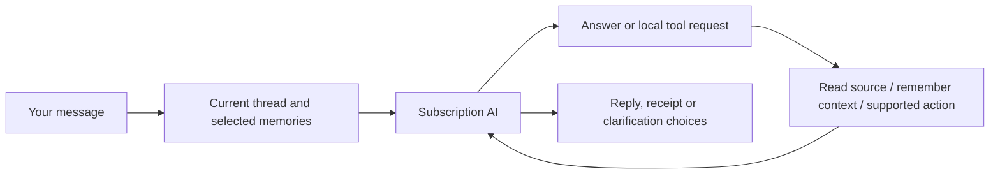

# How Mission Control works

Mission Control combines a custom dashboard with a personal assistant. Apple Calendar, Reminders and Mail remain the original sources. The assistant can retrieve information, remember useful context, suggest work and carry out supported Calendar/Reminders changes through local tools.

## The dashboard

Pages hold movable, resizable widgets. A page fits the window; content inside a widget can scroll. Pages have selectable icons. Toolbar arrangement is saved separately from widget layouts. Workspace and individual widget colours are customisable.

Current widgets include Calendar, Reminders, Mail, Today's brief, Email summary, Your PA, Tasks for you, Date & clock and Life map. Adding or viewing a widget does not itself start an AI request.

## A PA conversation

The app supplies recent conversation, relevant permitted memory and bounded source context. The AI can ask local tools for more detail. It may ask one clarification when something essential is missing, rather than requiring a rigid command phrase.

Supported Apple changes resolve exact issued record identities, check fresh revisions and verify saved results. A saved memory or an imported message cannot independently authorise a change. Mail and WhatsApp have no sending capability. Local email reply drafts can be edited, saved and copied for your own review.

A foreground turn has limits: six inference rounds, twelve tool calls, at most four Apple changes and two Mail continuations. It can report partial work rather than implying an unlimited background agent completed everything.

## Memory: what exists today

| Layer | What it contains | How it is used |
| --- | --- | --- |
| Recent conversation | Recent completed messages in the current general/topic thread | Follow-ups, references and conversational intent |
| Saved facts | Preferences, context and commitments, with account/topic ownership | Relevant recall between conversations |
| Connections | Evidence-backed subject → relationship → object links | Related recall and the Life map |
| Source records | Cached/fresh Calendar, Reminders, enabled email and selected WhatsApp text | Lookups and bounded source context; not all automatically permanent memory |

Useful facts can be learned naturally, without a remember keyword. The foreground `remember_context` tool checks the human evidence and meaning. A separate bounded learner also assesses small batches of eligible human messages when its controls and background conditions allow.

Stable directly stated facts persist until corrected or forgotten. Inferred facts are provisional; older provisional context requires review after 90 days. Resolved commitments are excluded from ordinary recall. Passing a date does not prove a task is complete.

Recall currently uses words and one-hop connections, capped at 40 memory records and 20,000 bytes. It is not yet a semantic embedding index or a complete knowledge graph. The Life map displays a bounded projection of usable connections, with dashed provisional links and evidence inspection. An attractive or crowded graph is not evidence that the assistant understands everything.

You can inspect, correct, confirm and forget memories. Forgetting suppresses automatic re-learning from the original conversational turn. Existing records and transcripts are preserved across these additions.

## Topics: current behaviour and intended direction

**Today:** General has its own ongoing transcript. Each named topic has a separate ongoing transcript, a focus description and additional scoped memory. All topics can also use shared PA memory. The Life map can display shared memory or shared plus the selected topic's memory. This is scope filtering, not yet graph-region focus.

**Next:** a topic such as Engineering should point to a relevant area of one connected life notebook: course, modules, projects, deadlines and related career goals. Selecting Engineering should prioritise that area while keeping useful shared context available. Topic transcripts can remain separate; focusing an area must not automatically broaden source permissions or mix accounts. Deliberately scoped private topic memory must keep its boundary.

## Questions and setup

Set up my PA opens a dedicated memory interview, separate from your normal chat and its unfinished draft. Start it explicitly, then answer one short question at a time. It builds breadth across questions, using existing shared/current-topic memory to avoid repeating what it already knows. Questions have a completed-output length/format check; a failed response offers Continue instead of pasting a long answer into the normal chat.

The interview has its own saved account/topic/session transcript and answer draft. Close pauses your interaction without deleting them; Continue memory setup reopens it. Skip moves to another question. Finish ends that interview while retaining its answers and any facts already saved; another setup starts a new interview. The interview exposes only memory tools, never Calendar/Reminders changes or source reads. Normal PA chat keeps its full task tools. New interview turns are excluded from ordinary chat/history, while real answers remain eligible for existing bounded memory learning; synthetic start/skip/continue controls are excluded. Existing old setup messages are preserved. Actual recall and question quality still need live evaluation.

Occasional learning questions also exist: at most one per local day, grounded in eligible human conversation and included in the existing bounded learning pass. They can be dismissed and undone. This is not yet an autonomous interview based on every source in your life.

## Queued work and handoffs

You can queue another request while the PA replies. Requests capture their account and topic and execute serially once the queue is explicitly started. Completed queued work stays in Tasks for you as a handoff.

A genuine clarification pauses advancement. A failed/stopped request also pauses it. On relaunch, unfinished running requests become interrupted and are not replayed automatically. This avoids blindly repeating a possible Apple change. Waiting requests can be continued explicitly.

Tasks for you also shows existing grounded recommendations and prepared email replies. A draft is a proposed output, not proof that every sentence is correct or that an email has been sent.

## Background work

The app has separate bounded jobs for incoming-email assessment, morning brief preparation, conversational learning and proactive source comparison. They respect their controls, source selections, account ownership and subscription limits. They do not all run on every refresh. Ordinary source refresh/reception makes no AI calls.

Today's morning message is saved once. An explicit daytime update is separate and does not deliver another morning notification. Email monitoring prioritises relevant new mail rather than summarising a historical backlog. WhatsApp reception caches partial linked-device text locally; PA access and brief inclusion have separate selected-chat controls.

Broader source-origin memory learning, canonical hub notes and automatic reversible memory consolidation are still planned. Current access does not mean every available email or WhatsApp message is automatically analysed into permanent memory.

## Where information lives

Code and this project notebook are in this Git repository. App records are outside Git in local application storage; preferences use the app's settings domain. Credentials use Keychain. The WhatsApp helper's session and message cache are encrypted with a Keychain-held key. This does not mean every ordinary app record is encrypted in the same way.

Selected source context is sent to subscription inference when the corresponding AI feature runs. There is no API-key billing fallback. The app needs an awake Mac for local jobs; a sleeping Mac cannot be assumed to run them on schedule. Permissions belong to Mission Control itself.

## How we know a change works

There are separate checks for compilation, signing, deterministic fixtures, process launch and live interface/source behaviour. Some recent graph/setup/queue interaction checks remain pending because app control was unavailable. [STATUS](../STATUS.md) is the record of what was actually verified, not merely intended.
