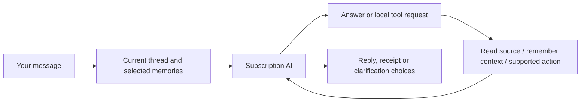

# How Mission Control works

Mission Control combines a custom dashboard with a personal assistant. Apple Calendar, Reminders and Mail remain the original sources. The assistant can retrieve information, remember useful context, suggest work and carry out supported Calendar/Reminders changes through local tools.

## The dashboard

Pages hold movable, resizable widgets. A page fits the window; content inside a widget can scroll. Pages have selectable icons. Toolbar arrangement is saved separately from widget layouts. Workspace and individual widget colours are customisable.

Current widgets include Calendar, Reminders, Mail, Today's brief, Email summary, Your PA, Tasks for you, Date & clock and Life map. Adding or viewing a widget does not itself start an AI request.

Opening a Calendar widget returns it to today, including when switching dashboards or calendar widgets in Focused view. Day/Week also refocuses the current time, like Now. Browsing dates while the widget stays open still works; view mode and source filters are preserved.

Date & clock’s Adaptive face measures the localised date/time text and scales it to fill the available width and height, without a fixed maximum font size. Adaptive layout puts the date and time side by side in wide widgets; Digital and Calendar layouts are selectable from its ellipsis menu, alongside Centre/Leading alignment, clock visibility, seconds and 24-hour time. These are local per-widget preferences. Ellipsis menus use only three dots.

## A PA conversation

The app supplies recent conversation, relevant permitted memory and bounded source context. The AI can ask local tools for more detail. It may ask one clarification when something essential is missing, rather than requiring a rigid command phrase.

Supported Apple changes resolve exact issued record identities, check fresh revisions and verify saved results. A saved memory or an imported message cannot independently authorise a change. Mail and WhatsApp have no sending capability. Local email reply drafts can be edited, saved and copied for your own review.

A foreground turn has limits: six inference rounds, twelve tool calls, at most four Apple changes and two Mail continuations. It can report partial work rather than implying an unlimited background agent completed everything.

## Memory: what exists today

| Layer | What it contains | How it is used |
| --- | --- | --- |
| Recent conversation | Recent completed messages in the ongoing general PA conversation (legacy thread tags stay saved) | Follow-ups, references and conversational intent |
| Saved facts | Preferences, context and commitments, with account/topic ownership | Relevant recall between conversations |
| Connections and organisation | Evidence-backed subject → relationship → object links, typed endpoints and life areas | Connected recall, area notes and the Life map |
| Correction history | Original and replacement facts with separate evidence and IDs | Current recall uses the latest belief; earlier versions can be inspected/restored |
| Source records | Cached/fresh Calendar, Reminders, enabled email and selected WhatsApp text | Lookups and bounded source context; not all automatically permanent memory |

Useful facts can be learned naturally, without a remember keyword. The foreground `remember_context` tool checks the human evidence and meaning. A separate bounded learner also assesses small batches of eligible human messages when its controls and background conditions allow.

Stable directly stated facts persist until corrected or forgotten. Inferred facts are provisional; older provisional context requires review after 90 days. Resolved commitments are excluded from ordinary recall. Passing a date does not prove a task is complete.

Recall uses local word relevance, selected life-area preference and up to two hops through typed connected entities, capped at 40 records and 20,000 bytes. The universal self node is excluded from expansion, so asking about one project does not pull in every fact about you. A separate bounded notebook context supplies up to four relevant areas, each with up to six source facts, within 8,000 bytes. These are useful recall layers, not a semantic embedding index or a complete biography.

There is one account-owned self identity. First-person links attach to it; an explicitly supported own-name annotation labels it. A person sharing your name remains a separate contact. Goals, habits, projects, values and personality traits have distinct types. Broad areas include About me, Studies, Career, Personal projects, Interests, Wellbeing, People, Home and Administration. Facts may belong to several areas without being copied. The current taxonomy is a starter set, rather than arbitrary nested personal folders.

The Life map widget offers Map and Notes views. Map starts from you and shows coloured area hubs; selecting an area reveals its typed entities, facts and evidence-backed relationships. Notes offers the same facts directly. Area branches are navigation, not newly inferred relationships. Empty areas are hidden, and missing notes mean unexplored context rather than proof that an activity is absent. Unclassified legacy facts stay in Not yet organised. Organisation can be edited/pinned without rewriting the fact or its original evidence.

You can inspect, correct, confirm and forget memories. A correction creates a new current version and preserves the old wording/evidence as history. Show earlier versions and Restore are available in Memory. Forgetting a current belief removes its correction lineage and suppresses relearning from its original/correction turns; a local Undo restores the removed records. Old superseded evidence is also excluded from ordinary recall and cannot be reinserted by a background learner merely paraphrasing the same quoted evidence. This is conservative history protection, not complete automatic contradiction detection.

## Focus

The PA now uses one ongoing general conversation. Its Focus control lets you choose several life areas, such as Studies and Career, or All areas. This biases relevant recall; it does not start another chat or prevent an explicit question from using other relevant memories. The Life map has its own Focus control for displaying a subset of areas. Choices are saved per widget and account; the expanded PA view saves its account preference separately. Each new request and queued request captures the selected areas when submitted, so later changes do not retarget work already running.

Earlier named-topic transcripts, drafts, IDs and memory ownership are retained in storage without merging or deleting them. The new selector does not browse those historical transcripts. A previous topic's area preference seeds Focus until a new choice is saved. Normal Focus chat and the Life map can retrieve this account's usable earlier topic memories as part of the same notebook. New normal-chat memories are shared. Other accounts and disabled source context remain excluded; Focus grants no source access or write permission. Existing legacy queued work retains its original captured thread.

This is multi-area focus, not arbitrary entity anchors or a global alias registry. Account and source-permission filtering still precede notebook projection and connected retrieval.

## Questions and setup

Set up my PA opens a dedicated memory interview, separate from your normal chat and its unfinished draft. Start it explicitly, then answer one short question at a time. It builds breadth across questions, using this account’s existing permitted notebook memory to avoid repeating what it already knows. Questions have a completed-output length/format check; a failed response offers Continue instead of pasting a long answer into the normal chat.

The interview has its own saved account/topic/session transcript and answer draft. Close pauses your interaction without deleting them; Continue memory setup reopens it. Skip moves to another question. Finish ends that interview while retaining its answers and any facts already saved; another setup starts a new interview. The interview exposes only memory tools, never Calendar/Reminders changes or source reads. Normal PA chat keeps its full task tools. New interview turns are excluded from ordinary chat/history, while real answers remain eligible for existing bounded memory learning; synthetic start/skip/continue controls are excluded. A rich answer can produce several distinct concise facts from the same turn. Confident organisation is attached in the original save, rather than requiring an administration call for every fact. Questions use the notebook's known/unexplored areas to build breadth before probing details. Existing old setup messages are preserved. Fictional subscription evaluations and live personal interview acceptance are recorded separately in STATUS.

Occasional learning questions also exist: at most one per local day, grounded in eligible human conversation and included in the existing bounded learning pass. They can be dismissed and undone. This is not yet an autonomous interview based on every source in your life.

## Queued work and handoffs

You can queue another request while the PA replies. Requests capture their account and current Focus and execute serially once the queue is explicitly started. Completed chat replies remain in the PA conversation; they no longer clutter Tasks for you. Pending, interrupted or answer-needed work remains visible there.

A genuine clarification pauses advancement. A failed/stopped request also pauses it. On relaunch, unfinished running requests become interrupted and are not replayed automatically. This avoids blindly repeating a possible Apple change. Waiting requests can be continued explicitly.

Tasks for you prioritises source-linked missing-plan suggestions, emails needing action and prepared replies. Monitored new emails can produce local drafts during their existing assessment job. Older eligible reply-needed cards offer Draft reply: one fresh read-only email-body lookup and bounded subscription request, with account, source, model and memory checks before saving. Drafts use placeholders for unknown availability or decisions; Review draft supports editing, saving and copying. Nothing is sent or written to Mail.

Suggestions compare bounded email assessments and recent selected WhatsApp text with fresh enabled Calendar/Reminders records. Existing similar plans count as coverage; partial source access is not proof that no plan exists. Each card retains an exact source quote and identity. Review suggestion opens the native event/reminder review form; only the human's explicit Create saves it. A draft or suggestion is proposed work, not proof that it is correct, complete or accepted.

Settings → WhatsApp → PA chat access → Suggest useful tasks from recent selected chats is a separate off-by-default opt-in. The existing idle proactive job may compare at most eight cached selected-chat messages from the last 48 hours, with the existing three-suggestion/day and automatic attempt/cooldown limits. Tasks refresh can request one comparison of currently shared chats even when automatic inclusion is off. Foreground chat access alone does not enable this background work. Access revocation, linked identity changes, edits and cache absence hide dependent WhatsApp suggestions and refuse stale native saves. Source refresh/reception still makes no AI request.

## Background work

The app has separate bounded jobs for incoming-email assessment, morning brief preparation, conversational learning, existing-memory organisation and proactive source comparison. They respect their controls, source selections, account ownership and subscription limits. They do not all run on every refresh. Ordinary source refresh/reception makes no AI calls.

Notebook organisation classifies already-saved human facts only. It preserves the original text/evidence and never scans Mail/WhatsApp or changes Apple records. Its own automatic control is default-on, additionally requiring memory and conversation learning enabled; it runs only when idle, at most two eight-fact passes per account/day with a 30-minute cooldown. A manual Organise memories action from Focus processes up to four small batches across this account’s shared and earlier-topic human memory. Manual pins are protected. Interrupted/failed work remains paused until explicitly resumed. These are incremental classifications, not automatic semantic merging or deletion.

Today's morning message is saved once. An explicit daytime update is separate and does not deliver another morning notification. Email monitoring prioritises relevant new mail rather than summarising a historical backlog. WhatsApp reception caches partial linked-device text locally; PA access and brief inclusion have separate selected-chat controls.

Broader source-origin memory learning, reusable non-self entity/alias identity and automatic reversible semantic consolidation are still planned. Current access does not mean every available email or WhatsApp message is automatically analysed into permanent memory. Area notes are evidence-linked projections of existing facts, not separate AI-written biographies.

## Where information lives

Code and this project notebook are in this Git repository. App records are outside Git in local application storage; preferences use the app's settings domain. Credentials use Keychain. The WhatsApp helper's session and message cache are encrypted with a Keychain-held key. This does not mean every ordinary app record is encrypted in the same way.

Selected source context is sent to subscription inference when the corresponding AI feature runs. There is no API-key billing fallback. The app needs an awake Mac for local jobs; a sleeping Mac cannot be assumed to run them on schedule. Permissions belong to Mission Control itself.

## How we know a change works

There are separate checks for compilation, signing, deterministic fixtures, process launch, actual subscription-model quality and live interface/source behaviour. The manually invoked fictional notebook evaluation checks typed identity, areas, evidence-backed recall, unknown information and natural correction intent. It also exercises the production memory-only setup tools with a disposable in-memory database. It never stores fiction in your profile or sends real sources. Some graph/setup/queue interaction checks remain pending because app control was unavailable. [STATUS](../STATUS.md) is the record of results and limits, not merely intended behaviour.

Memory tool failures now appear in **Memory tool notes** on the relevant reply or interview. Supporting quotes preserve the actual current human wording while tolerating formatting differences. Unsupported graph-link evidence can be omitted independently of a fact, but facts and retained relationships still need human-statement validation. Old failures cannot be reconstructed if their tool details were never saved.

### Learning from selected WhatsApp context

In Settings → WhatsApp → PA chat access, **Learn useful context from recent selected chats** is a separate opt-in. Reading chat tools or enabling Today’s brief does not activate it. Small recent batches run only while the app is idle and the learning controls/connection permit them. These batches share a persisted four-pass/day,30-minute-cooldown learning budget with conversation learning and notebook organisation. Interrupted jobs remain paused; Settings → Assistant → Check recent WhatsApp context resumes one bounded pass.

Source memories contain the exact quote and source identity/revision. They are always initially provisional and situational, never a user-stated preference. The source cache remains encrypted; derived facts/quotations are stored in the existing local PA memory store alongside other memories. Nothing is committed to Git. Source access, linked identity, current cached content and memory scope gate recall. Exclusion, edit or cache absence removes the affected source memory from foreground recall and the notebook; review/history records remain saved. Forget suppresses the same evidence version. A later human statement can establish independent human memory rather than being deduplicated against a provisional source guess.

These new source memories currently feed foreground chat/notebook retrieval. Automatic brief/proactive memory inputs remain human-only until those persistent artifacts also support source-memory dependency invalidation. New chat replies save conservative dependency IDs and are omitted from subsequent AI history if those source beliefs become unavailable. This does not delete the local transcript.

### Appearance and PA name

Choose **3PO** in Customise colours for coordinated light/dark gold, ivory and bronze profiles. Existing themes and individual widget overrides keep their behaviour. Use the PA’s ellipsis menu → **Name your PA…**, or Assistant settings, to choose a name. This is a local display preference, not a new thread or memory profile. The default remains Your PA. Name changes during an AI request invalidate late output.

The Life map uses a stable bilateral layout on wide widgets and a single trunk on narrow widgets. It places area cards around the owner without overlapping labels. Dotted highlighted branches mean the selected area shares a saved fact with that area; branches organise notes rather than claiming every displayed area is a new factual relationship.

The Life map widget has a compact Map/Notes switch without a search row. Its map scales uniformly to fit the available width and height; wider widgets keep the diagram centred rather than stretching branches. Click an area to browse its notes and evidence in a separate detail view. Notes can scroll; the map overview stays fully visible. Detailed organisation status is available from the saved-fact count tooltip. Memory management retains its own search.

### Local Weather and explicit brief refresh
Add widget → Weather adds a theme-aware local forecast with a large condition icon/daily high, rain chance, maximum wind and a three-day outlook. Short widgets simplify their content to keep the forecast readable. It shares the existing coarse-location Open-Meteo cache and weather permission/toggle; viewing it performs only a bounded weather refresh, with no AI request or permission prompt. The existing Today’s brief weather card remains available. A fresh forecast spanning midnight selects the actual current local day rather than its first cached day.

Today's brief hides a saved morning message when its source choices differ from the currently permitted choices. Update brief prepares a separate current-source update while preserving the original morning record and its delivery/notification claim. Manual preparation does not require enabling automatic 7:30 preparation. An explicit request waits up to three minutes for an already-running background job, reserving the brief slot without overlapping inference; Stop cancels that wait. Missing connection/context, other foreground work, interrupted requests and source changes have visible explanations. Normal dashboard/source refresh still performs no AI inference.

Structured memory supplied to AI uses consistently ordered JSON for nested organisation, connections and source evidence. This makes captured context comparable: unchanged memory no longer falsely invalidates briefing preparation, while actual memory/source/account/control changes still reject stale output. Storage format, memory evidence and ownership are unchanged.

### WhatsApp names and selected sources
WhatsApp sources opens on **Selected**, with a compact list of shared chat names and Brief/Tasks/Learning status. **All chats** and name search let you change that selection; each row shows the amount of locally cached text. Contacts without cached messages may be listed, but this never implies full chat history. Missing cached selections stay visible in Selected and are not silently removed.

Contact labels are stored in a separate encrypted local directory. Saved contact names take priority over profile names; explicit WhatsApp phone/linked-address mappings connect display labels without merging message IDs or expanding PA access. Existing encrypted session mappings are used to backfill older cached chats. On the first authenticated connection after this update, one contact-metadata collection is refreshed to recover saved address-book names; **Refresh names** repeats that read if needed. This does not fetch message history, send messages/receipts/presence or call AI. New contacts/chats stay unselected. Names remain dependent on what WhatsApp shares with the linked device.

### Selective briefs and preparation checks
The PA chooses useful material rather than listing every new message. It prioritises concrete requests, decisions, deadlines and meaningful updates connected to your day. Routine chat, adverts and acknowledgements can be omitted. Email and WhatsApp receive a short status: either worthwhile follow-ups, or that nothing important stood out in the material checked. Disabled sources or an empty cache are described as not checked/unavailable, rather than a claim that nothing important exists. Email uses bounded saved assessments; WhatsApp uses partial recent selected-chat text. Neither means the whole inbox/history was checked or every reply status is known.

Calendar/Reminders sync notifications trigger a fresh comparison of the supplied records and original source identities. An unchanged re-read can finish; real changes during inference reject the old result. Collection retries at most three times while native sources settle and never retries an AI request. Account, model, memory, permissions and selections still have independent checks. A WhatsApp connection is checked only when WhatsApp is included in that brief; changing brief inclusion itself still invalidates preparation. If a check fails, the message identifies which part changed.

Email assessment saves completed results before pausing on a connection failure. Tasks for you exposes Resume email processing for that paused work; its refresh icon checks proactive suggestions separately. Resuming preserves the monitoring start date and existing assessment checkpoints, rather than restarting historical indexing.

## Calendar and reminder customisation
Open an item to edit its title, native Calendar/list, dates, notes, URL, repeat rules and time alerts. Reminders also expose priority; Calendar exposes availability where supported and the event timezone. Custom repeats use day/week/month/year intervals, selected weekdays or numbered weekdays, month/year patterns and an optional end date or count. Forever has no end condition. Existing native repeat rules and specialised alerts are preserved unless a supported field is explicitly changed.

Repeating Calendar items offer Only this event or This and all future events. Repeat-pattern changes and moving a series between calendars require the future scope. Delete offers Delete only this event and Delete all future events; future scope includes the selected occurrence and preserves earlier events. A repeating reminder is one native task: edits/deletion affect that repeating reminder; completion remains a separate current-task action. Deletion and series changes do not offer Mission Control Undo.

The PA uses the same native operations. It reads exact IDs and current item details, validates the latest human's intent independently of imported source data, checks full exposed fields/revision immediately before a save, and persists an operation claim before attempting a write. An interrupted/pending operation is not blindly repeated. Requests like “delete all future study sessions” can resolve the scope directly; a bare “delete that repeating event” asks which scope. Normal dashboard refresh still makes no AI requests.

These controls are not complete Apple-app parity. Tags, subtasks, attachments, invitations, provider-specific features, completed-history browsing, source administration and specialised location-alert editing are not implemented in this increment. Unsupported native metadata remains owned by Apple apps.

The 3PO macOS app icon uses the selected gold robot artwork in a standard Xcode AppIcon asset catalog. macOS compiles it into its native rounded tile treatment. Xcode generates the bundled ICNS and icon metadata; the Dock uses the system-provided icon without a raw-image override so native corner masking remains intact. Updating the app retains its bundle identity and local data.

PA replies and newly prepared/updated briefs request restrained inline Markdown emphasis: bold key headings/actions/times and occasional italics. The current brief, original morning disclosure and supporting prose render both while preserving paragraphs. Existing saved prose remains unchanged.

The app is now named 3PO (`~/Applications/3PO.app`). Bundle ID `com.mylomichael.missioncontrol`, Swift module `MissionControl`, Application Support/Mission Control, account registration, Keychain identities and stored transcripts/layouts remain unchanged. The assistant's separately customisable display name remains its existing preference.

The dashboard sidebar and native top toolbar share the sidebar palette colour in light/dark modes. The canvas has a rounded upper-left corner and reaches the right and bottom window edges; sidebar colour covers only the left and top. Sidebar collapse keeps a 56-point icon rail with page tooltips/accessibility names, page context menus and a bottom New dashboard +; expanding restores labels. Existing workspaceSidebar preference still controls expansion, and page/widget IDs/layouts are unchanged.

## Durable life and projects

The optional Projects widget and Life map Structure tab display a durable shared hierarchy of areas, organisations, courses, projects, sections and work. Open branches, edit details, search, or choose Overview/List/Board/Outline/Deadlines. Each widget keeps its own view and account-specific starting branch. The PA reads and edits the same records using ordinary understood human intent and exact issued identities. Cross-links can connect branches, permitted memory and available source records without changing their source. Local task completion is separate from native Reminder completion. No project inference runs on refresh.

See [Life and project workspace](PROJECT_WORKSPACE.md) for use, memory/source distinctions, Undo and current limits.
