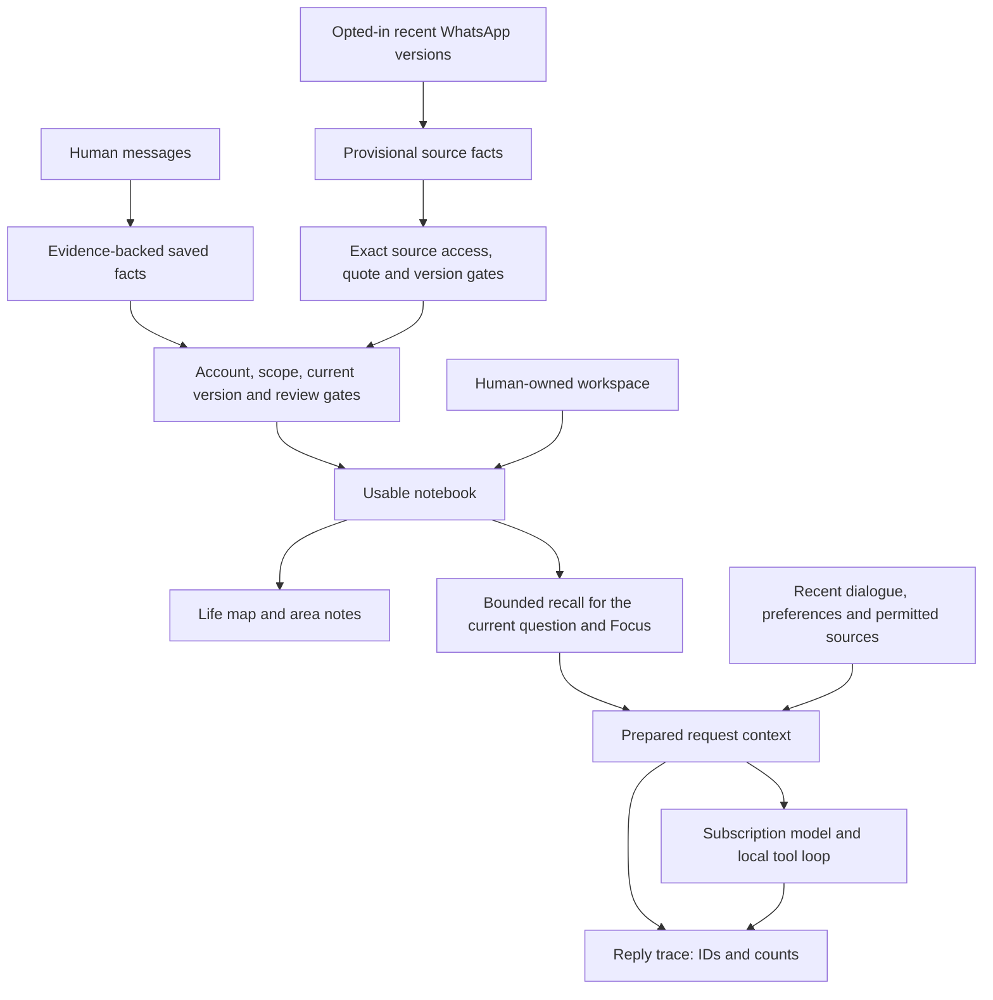

# Memory and context in 3PO

The PA has a saved notebook and builds a smaller working context for each request. The Life map shows the usable notebook and your workspace. It does not show every cached message, saved transcript or input used by an AI request.

## The short explanation

**Collect → remember → connect → recall → maintain.**

1. **Collect:** permitted conversations and source changes supply evidence. Collection itself uses no AI.
2. **Remember:** save useful preferences, context and commitments with their origin, dates and certainty. A source report remains attributed to its source.
3. **Connect:** link facts to people, life areas and your durable projects. You can explicitly connect remembered reports about the same plan. Projects keep their own stable identities; memory is associated with them rather than copied into another brain.
4. **Recall:** select current, permitted facts and relevant project context for this question. Keep original evidence available for checking.
5. **Maintain:** version corrections, revisit unpinned organisation, resolve remembered commitments and retire outdated human context from recall while retaining evidence. Forget is the separate deletion action.

This is the organising model. Conversation learning and separately opted-in WhatsApp, Calendar, Reminders and Mail learning can create lasting provisional facts. A bounded human-memory review can propose duplicates, conflicts or old provisional context to retire. It does not automatically merge identities, choose a conflict winner or retire/delete facts. Nothing in this explanation claims every input has already been learned.

## Inspect it in the app

Open **PA menu → Memory**, **Life map → Memory & context → Inspect memory & context**, or **Settings → Memory → Inspect saved memory and recall**. Opening, searching or previewing recall makes no AI request and does not refresh sources.

- **Overview** explains the layers, counts saved records/current versions/available records, lists exclusion reasons and previews saved-fact selection for a question and Focus.
- **Facts** shows original facts, certainty, evidence and dates. View version history, confirm, edit, organise, resolve, retire/restore human context, or forget a fact. These are explicit local operations; resolving memory does not complete a Reminder.
- **Life areas** groups currently usable facts and workspace anchors. Select an area to inspect its facts and recorded relationships. Area branches navigate the notebook; they are not inferred relationship claims.
- **Life map items** are actual saved workspace entries: areas, courses, projects, headings, resources/notes and work items. Opening an area lists the same counted entries with their type and parent path. Open an entry to browse its contents, then return with Back. Remembered concepts and facts are labelled separately. Opening makes no AI request or edit.
- **Review** offers possible duplicates, conflicts and retirement candidates with their exact saved facts/evidence. Review now is explicit; weekly background review is optional/off by default. A changed fact invalidates its proposal. Inspect/correct duplicates or conflicts; retirement is a separate reversible human choice. Dismissal supports Undo.
- **Controls** contains the memory-use, human-conversation learning, optional question and existing-fact organisation controls. WhatsApp learning remains a separate opt-in in its source controls.

New foreground replies offer **Context details**. It records the IDs of the initial saved-fact selection, facts in the separate notebook input, additional memory-tool reads, bounded dialogue/excerpt counts, workspace IDs, model, captured Focus and whether a cached source snapshot was prepared. Tool names mean attempted tools; verified changes are shown in their existing receipts. This trace explains prepared inputs, not model attention or reasoning. Older replies have no invented trace.

The trace stores no extra copy of memory prose, source bodies, prompts, tool arguments, credentials or model reasoning. Inspecting a saved ID shows the fact as it exists now: it may have been corrected, become unavailable or been forgotten since that reply. It is not a historical plaintext prompt export or an exhaustive tool-result audit.

## Feedback about what deserves review

Feedback's editable About field is retained as a human-confirmed topic anchor, separate from the exact feedback evidence. It gives context to words such as these/this without turning source text into a human assertion or a blanket sender rule.

**Review → Feedback → Save to memory** stores your exact explanation as a stated, shared PA preference for the active account. Saving is local and makes no AI or source request. Your email is context for the prompt; its body is not saved as your own statement. Dismiss remains acknowledgement and does not create a preference or complete a task.

**Review preferences** and the Overview's **View preferences** button inspect these same canonical memory records. Edit retains the old words/evidence as version history. Disable excludes the preference from recall; Restore brings it back. Facts exposes the original evidence, versions and Forget. Earlier topic/direction preferences remain separately inspectable, without an automatic migration or merge.

Relevant feedback is prioritised in bounded header/body review. Full conditional wording is supplied, including exceptions, with exact memory receipts. Routine assessment confirmations can stay quiet while invitations, new stages and results remain worthwhile. Changed relevant feedback schedules bounded reconsideration of current recent assessments, preserving acknowledgements and existing Mail progress. General PA/brief/proactive recall uses these same permitted preferences when selected. This is explicit learning from human feedback, not automatic semantic consolidation or a claim that every preference is recalled perfectly.

## The structure

| Layer | Durable record | Authority and purpose |
| --- | --- | --- |
| Human conversation | Account-owned messages with original IDs, optional legacy scope, Focus and interview tags | Current human intent can authorise a supported change. Historical dialogue alone does not authorise a new change. |
| Human memory | `PAMemory`: preference, context or commitment; stated/inferred, stable/situational, evidence, dates | Useful personal knowledge. Confirmed/stable stated facts persist; provisional interpretations remain distinguishable. |
| Source memory | The same `PAMemory` type with exact source identity/version/quote and optional supporting evidence/report state | Attributed source interpretation, separately permission-gated; never human assertion or action authority. |
| Belief history | `supersedes` / `supersededBy` between unchanged record identities | Current belief is used; old wording/evidence stays inspectable. Restore makes a new current version. |
| Organisation | Optional areas and typed endpoints referring to the fact's existing connections | Navigation and recall metadata. Manual organisation is pinned; organisation cannot invent a fact. |
| Workspace | `LifeWorkspaceStore` human-owned projects, headings, notes, tasks and exact source pointers | Editable durable content, with hierarchy/order/tombstones. Mentioning a project is not permission to create one. |
| Notebook / map | `LifeNotebook` plus canonical workspace-anchor projection | Derived usable facts and exact workspace identities. It is rebuilt locally, not another independently editable memory database. |
| Working context | Request-local selection, notebook notes, dialogue, preferences, cached snapshot and tool results | Bounded information for one request; ownership is captured before inference and checked before outputs/actions. |
| Reply trace | Optional `AssistantTurn.contextCapture` | IDs/counts for inspection; separate from source-dependency guards and action receipts. |

## Saved, current, available and selected

**Saved** includes old versions, resolved commitments, facts needing review and source-derived records outside current access. **Current** means no newer version supersedes it; that alone does not make it usable.

**Available** additionally requires the active registration, permitted scope, no resolution/invalidation, any required provisional review, and current source access for every retained quote. Inferred/situational context needs review after 90 days. Stable directly stated human facts are retained. Source cache loss is unavailability, not evidence of deletion or completion. Turning memory use off selects no saved facts; the records and their saved states remain inspectable.

**Selected** is the smaller set supplied for a particular question. A targeted query must match useful words, a recorded connection within two hops or an explicitly human-linked plan. It can select **zero facts**; unused capacity is never filled with an unrelated biography or pinned preferences. The supported self-name is excluded from query terms so addressing you by name does not retrieve your whole life. Focus changes ranking; with an otherwise empty query it can deliberately explore that area, but it does not make every Studies fact relevant to a security alert. Certainty/kind/scope and review date break ranking ties. The input remains capped at 40 records and 20,000 UTF-8 bytes.

A null query explicitly asks for bounded broad orientation, including a small core of confirmed preferences. The daily brief uses this broader day-planning context. Memory/notebook tools expose null for a deliberately broad life overview or setup; ordinary foreground questions have a targeted query. Background source suggestions without a query receive no memories. Email classification selects human facts from its subject, sender and bounded body; actual reply drafting additionally looks for writing-style preferences. Source facts remain excluded from email classification/drafting because that lane has no source-memory receipt. Review batches build a bounded query across the supplied emails/messages, rather than truncating everything after the first long message.

This is local word/typed-link retrieval, with no extra AI or embedding call. It improves precision but cannot guarantee semantic relevance, recognise every synonym or separate unrelated clauses within one saved fact. Those remain quality work, not a claim of perfect recall. Its local explanations come from the same ranking pass as the production selection.

8 October email relevance extension: targeted human-origin recall and current human workspace anchors now reach the header gate as well as body assessment. Header/body caps are respectively two/six facts and two/four anchors, with two/four matching explicit attention preferences. Notebook anchors share the selected human-fact IDs and require query relevance or a supported link. A positive email connection stores exact belief fingerprints, workspace/preference revisions and a source quote; current consumers remove stale boosts and reject advice using changed assessments. Source-derived facts remain excluded from classification until its own source-memory dependency contract is implemented. Review attention preferences are separate editable account-owned records, never source-authored Life-map facts or inferred completion. Historical 8 October behaviour also supplied weak dismissal examples. The 11 October change supersedes that part: Dismiss is exact acknowledgement only, and explicit human feedback teaches importance.

Recall and notebook context now use the same canonical workspace projection. A query matching a saved item's current label can favour its associated current facts, including facts whose prose still uses an earlier project name. Exact identity bindings preserve typed endpoints; ordinary memory references add associations without asserting identity. Saved references can follow a usable correction lineage; the original reference/evidence is not rewritten. Ambiguous same-name items are not merged, deleted items are excluded, and no unavailable, retired or superseded fact is made usable by a project link. Project details expose those current facts and their evidence. This is explicit/typed association retrieval, not semantic alias resolution.

The notebook is a second bounded input: up to four areas with six facts each, plus up to twelve workspace anchors, within 8,000 bytes. Targeted notebook facts are restricted to the same selected IDs, so the smaller notebook summary cannot reintroduce unrelated facts or bypass the selection budget. Anchors need a query match or a link to selected facts; linked-fact IDs are restricted to the selection. A small known-area/count index remains available for navigation. Broad overview can still explore the bounded notebook/workspace. The universal self node is not a traversal bridge to every area. Focus is a relevance preference: it can draw on other relevant areas and never grants source access. In a Focus conversation this account's usable earlier-topic memories are available; legacy queued/thread work retains its captured scope. Context details separately exposes notebook IDs and later memory reads.

The Review inbox's **Memory supplied** list is the captured context of the review batch, which may assess several messages. It is not proof that a fact influenced a particular suggestion. Existing dated receipts retain the facts originally supplied, even after retrieval improves; inspecting an older 15-fact suggestion must not silently pretend only today's smaller selection was supplied. New checks use the narrower selection. No fact is forgotten, corrected or removed merely because it is irrelevant to one task.

Recent dialogue is also bounded: up to twenty eligible completed turns and 24,000 bytes, with human dialogue prioritised over background deliveries. Earlier turns may be marked excerpts. Full visible history is kept separately. Source-dependent old assistant prose can be omitted from future AI history when its dependencies are no longer usable, without deleting the visible transcript.

## Evidence, corrections and source changes

Human memory points to the original statement. Source memory points to an exact account/container/message/linked identity, literal quote, content revision, message date and observation time. Up to three quoted versions support a source claim. Same-chat newer source updates can replace a provisional belief while retaining earlier evidence. A human-confirmed/human-origin fact is not silently overwritten by a source report.

Source states such as proposed, accepted, changed, cancelled or completed are attributed reports. A proposal is not automatically the user's obligation. A cancellation is not automatically a Reminder deletion. Calendar/Reminders tools still require understood current human intent, fresh exact record identities and verified native readback.

Human corrections atomically link the old and new beliefs. Current-belief Forget removes its lineage and suppresses its original learning evidence. Forgetting one explicitly selected historical version has narrower semantics. Dependent source quotations become unavailable; local Undo preserves independent Forget owners. The inspector follows a lineage in either direction without changing those deletion rules.

**Retire from recall** applies to current human-origin preferences/context. It saves `retiredAt`, retaining the same fact ID, prose and evidence. Retired facts leave saved-memory retrieval, the Life notebook and placement/organisation inputs; their projects, workspace links and original messages stay unchanged. **Restore to recall** clears retirement and records the human review, without turning an interpretation into a confirmed fact. Retirement persists across restart and cannot be silently undone by re-extracting the same human evidence. It does not erase independent recent dialogue or source context. Commitments use Resolve/Reopen; source beliefs keep their evidence/version/permission lifecycle.

The organiser first classifies unorganised human facts, then may reconsider unpinned classifications after 30 days. This is a conservative product interval, not a research-derived optimum. Manual **Organise now** can revisit sooner; existing eight-fact batches, two automatic passes/day, shared four-pass learning allowance, cooldown and paused-failure guards remain. Classification review is separate from a fact's evidence/review date: it never renews provisional truth, rewrites prose, merges facts, retires them or edits project content. Manual classifications remain pinned.

## Why this direction

The recommendation is a hybrid of evidence history, current facts, stable entity/project links and bounded working context. This is an engineering synthesis, not a claim that one benchmark proves the best PA architecture. [LongMemEval](https://arxiv.org/abs/2410.10813) makes updates, chronology and missing-information handling testable. [RecMem](https://arxiv.org/abs/2605.16045) supports evaluating selective consolidation rather than paying for every incoming interaction, while acknowledging that recurrence can miss important one-off events. [ScrubJay-MEM](https://arxiv.org/abs/2608.04746) supports separating perishable context from lasting knowledge; its results worsen on some consolidation tasks. [Zep](https://arxiv.org/abs/2501.13956) is a reference for connecting historical evidence to changing structured knowledge. We preserve exact identities and reversible history first, then measure semantic matching before expanding it.

Native adapters now emit exact bounded versioned evidence into separate account-owned assessment lanes, with baseline, pending and assessed cursors. These coordinate with WhatsApp learning through the shared learning allowance. An urgent one-off deadline must not wait for repetition. Missing access is unknown, not completion. AI maintenance may organise metadata and propose conflicts, duplicates or obsolete context; human-owned projects and confirmed memories retain their stronger authority. The map should expose current beliefs, their relationships and project anchors, with review/history accessible, rather than becoming a separately maintained store.

## Source coverage and background work

Source collection is separate from interpretation. Normal Refresh, Mail arrivals, WhatsApp reception and opening an inspector make no AI call. Automatic learning checks eligible deltas only through the idle scheduler. Conversation learning, optional source learning, existing-fact organisation and optional weekly review share four automatic passes/day with a 30-minute cooldown; failed or interrupted work remains paused for explicit continuation.

WhatsApp source learning currently assesses up to eight recent waiting versions with bounded neighbouring/saved evidence. Exact assessment receipts and pending references distinguish received, assessed and unavailable content. It does not sweep history or learn from every conversation. Mail is read-only through the native bridge; Cambridge Graph permissions are unavailable. Calendar, Reminders and Mail each have a separate default-off opt-in in Settings → Memory. Calendar consumes fresh 90-day orientation (up to 200 occurrences), Reminders fresh incomplete items (up to 200), and Mail exact retained quotations from matching selective assessments with a body check within 24 hours (among at most 200 current headers). The native cache must have a successful read within 30 minutes, current permissions and enabled source filters. Missing/ambiguous provider identities are skipped.

Each new opt-in establishes a baseline instead of indexing existing content. Automatic passes assess newly changed/recent versions; Review once explicitly permits one existing batch. Native changes waiting for quota remain pending while available. Lost pending versions are counted; old changes returning to a partial window remain baseline unless a fresh Mail body check verifies a known changed version. No extra source/body reads are initiated by these learners. Max eight inputs/four facts per pass, 12 KB source text/24 KB full input. Failed or interrupted claims remain paused, and exact assessment receipts prevent replay after a separate cursor save fails.

Calendar memory identity is independent of dashboard occurrence IDs: native item ID for single events, provider external ID plus original occurrence date for recurring/detached occurrences. Distinct occurrences remain distinct; missing or colliding identifiers abstain. Provider identifier changes after a sync/calendar move can make prior evidence unavailable; no title-based stitching is attempted. Native same-item revision updates can retain the same start/due/received date or move it earlier. They require the issued old evidence, a different current revision and a later observation. Earlier quotes remain version history; new native beliefs depend on the new exact version, not stale quotes. Existing WhatsApp chronology/multi-message support rules remain separate.

## Code and storage ownership

- `PAMemory.swift` defines facts, evidence and recall ranking. `PAMemoryStore.swift` owns the `paMemory` SwiftData cache envelope, correction/Forget transactions, permitted projection and notebook selection.
- `LifeNotebook.swift` builds area/entity/link notes; `LifeCanonicalNotebook.swift` projects durable workspace anchors. Original facts remain authoritative.
- `MemoryInspection.swift` explains the same recall gates. `MemoryInspectionView.swift` renders local inspection. It has no persistence, source refresh or inference path.
- `AssistantService.swift` assembles one initial selection and notebook context for both the request and its trace. `Conversations.swift` keeps the optional trace on the existing turn in `assistantConversations`.
- `PAToolSession.swift` records successful memory-read IDs separately from issued IDs. Issued IDs still control mutation safety; the trace grants no authority.
- `NativeSourceAdapters.swift`/`NativeSourceProjection.swift` project only fresh permitted cached data. `NativeSourceLearning.swift` owns bounds/baseline/decode; `NativeSourceLearningService.swift` owns account opt-ins and `paNativeSourceLearning` cursors. This envelope contains opaque hashes/references, not source text.
- `MemoryMaintenance.swift` selects bounded human facts and validates proposals. `MemoryMaintenanceService.swift` persists review controls/cursors/proposals in `paMemoryReview`; proposals never execute fact changes. Source learning, usage accounting, brief/proactive services and the queued-work store retain independent responsibilities.

The SwiftData cache is local Application Support data, excluded from Git. ChatGPT registrations live in Keychain; WhatsApp auth/message/name stores are encrypted with a Keychain-held key. Derived memory quotes and other SwiftData context are not all encrypted today; extending encryption and measuring deletion/retention coverage remain planned work. This is a personal development app, not a claim of a complete encrypted vault.

## What still needs work

The existing structure supports an inspectable, evidence-backed notebook. It does not yet provide reliable global aliases, semantic consolidation, a complete temporal commitment episode across email and WhatsApp across all consumers. Broader source coverage, semantic aliases/actual consolidation, sustained multi-turn quality evaluation, global background coordination and checkpointed delegated artifacts remain open. New automatic briefs/Tasks can use permitted source facts with persisted exact belief and communication receipts. Their source controls remain independent; historical outputs without receipts retain their existing behavior. Offline inference is later. See [Next improvements](NEXT_IMPROVEMENTS.md), [Architecture review](PA_ARCHITECTURE_REVIEW.md) and [STATUS](../STATUS.md) for delivery and live acceptance boundaries.

GPT-6 Luna exists in OpenAI's current [model documentation](https://developers.openai.com/api/docs/models/gpt-6-luna). Availability for this app is determined by the selected account's [subscription model catalog](https://developers.openai.com/siwc/token-sharing-open-source/models-and-inference), not by the Codex picker or API pricing page. **Settings → Connections → Refresh models · no AI** refreshes that catalog without changing the selected model or making inference. The separate access check explicitly spends one source-free request.

## Advice remains accountable to its context

New briefs and suggestions persist `memoryDependencies` alongside their existing records. `AutomaticMemoryContext` obtains one production selection and applies feature-specific permissions; `MemoryDependencies` hashes each supplied belief/evidence version. Native/WhatsApp permission projection and usability still govern validation. Metadata classification/review bookkeeping is omitted from the saved belief fingerprint; retirement, expiry, correction, resolution and source withdrawal remove usable support.

In-flight work compares the actual captured selection as well as its receipts. Saved outputs check only supplied dependencies, so unrelated new facts do not invalidate them. This is deliberately conservative: all supplied facts are dependencies, not only facts cited or demonstrably attended to. It is an inspectable input receipt, not a model-reasoning trace or human-write authority.

Mail outputs also capture their exact assessment/body/reply version. WhatsApp outputs retain opaque conversation-cache receipts for chats present in raw input or selected source facts. New replies/edits/cache loss invalidate the old context; this avoids assuming an unchanged original request is still current after a cancellation. Changes in an unrelated, unselected chat do not participate. These are bounded cache checks, not semantic commitment linkage or proof of a task state.

The immutable morning record survives with a saved-earlier note. If an update alone becomes unavailable, current consumers fall back to an independently usable morning while the widget still exposes the dated latest update. New update context, current advice, recovered discovery delivery, notifications and native/project review reject unavailable support. Visible chat history remains saved while unusable deliveries leave future inference history. A fresh explicit Update has the same original morning anchor and never creates a second morning delivery. Memory supplied in the brief/Tasks evidence panels exposes matching current receipt facts and explains unavailable ones. Older records decode without invented receipts. No additional AI or source reads originate in validation/inspection.

## Remembered reports of a plan

In Facts or a Life map commitment's detail, open **Remembered plan reports**. Each report keeps its exact evidence, attribution, source date and version. **Connect another report → Yes, same plan** makes a local, human-reviewed identity connection between two currently usable commitments in the same account/scope. **Keep this report separate** removes that member's connection. Neither operation confirms the reports, picks a truth winner, changes their wording/review date, resolves a memory or edits an Apple/project item. No inference or source refresh is involved.

Independent Mail and WhatsApp reports stay separate even when titles, dates or participants look similar. A source learner cannot assign this identity. Only a validated source supersession or same-scope human commitment correction inherits an existing connection. Kind/scope changes clear it. Forget and resolution preserve their existing meanings; restoring an earlier version cannot undo a later explicit disconnection. Two already-established groups cannot be silently merged. A group has at most 12 current reports.

Relevant connected reports receive a local recall boost only after account, scope, source permission and usability filtering. PA, brief and suggestion inputs include an additional plan index over the **same selected facts**: at most 12 groups/4 KB, exact fact IDs and attributed reported states, with mixed/unknown states marked uncertain. It adds no historical prose or unselected facts. Partial retrieval can omit reports; it never proves a full commitment history. A later date alone does not establish supersession across sources.

Group identity/revision is included in each fact's advice fingerprint. A local membership, report, version, resolution or Forget change revises remaining current group members, setting dependent advice aside even if it supplied only another member. Review/classification bookkeeping does not revise that claim set. Permission loss still follows the selected fact's existing live evidence gates; inaccessible claims never enter the index. Native source learning now accepts the same optional proposed/accepted/changed/cancelled/completed/unknown attributed report state as WhatsApp; legacy records without it remain unknown. Source-reported status never becomes Apple task status.

This is a human-reviewed connection foundation, not automatic semantic episode matching, cross-source cancellation adjudication, project/event identity stitching or a complete temporal ledger. Natural-language PA memory-connection tools and richer episode timelines remain future work. Communication review now supports inferred, evidence-backed native date-change proposals without a manual plan connection, but does not establish a permanent canonical episode/native binding.

## Inferred suggestions and confirmed connections

A useful suggestion need not wait for a manually connected memory group. The communication reviewer can compare distinctive recent message context with exact issued native records and prepare a date-change proposal in Review inbox. Its match explanation is explicitly inferred; ambiguity declines the edit. The user reviews the original item and approves a fresh, revision-checked save. This proposal does not merge memory claims, confirm a source report, change a project or create a global plan identity. Human-reviewed plan reports, source version history and actual Calendar/Reminder state retain their separate meanings.

Quiet/reported source assessments now have opaque persisted communication-review receipts. These say what was assessed under that context, not that all received content became memory or that an action was completed. Memory learning retains its separate opt-ins/cursors and budget. See [How it works](HOW_IT_WORKS.md) for schedules and approval recovery.

Life map fact details also show the existing recall status (available, earlier version, retired, resolved, needs review or source unavailable) and expandable version history. When memory use is paused, an otherwise available fact is labelled as paused. The map shows the latest 12 versions; Manage memories retains the full history and edit/restore controls. Original quotes remain hidden when the source version/access is unavailable. A saved belief is separate from a human-owned project or an Apple reminder.
