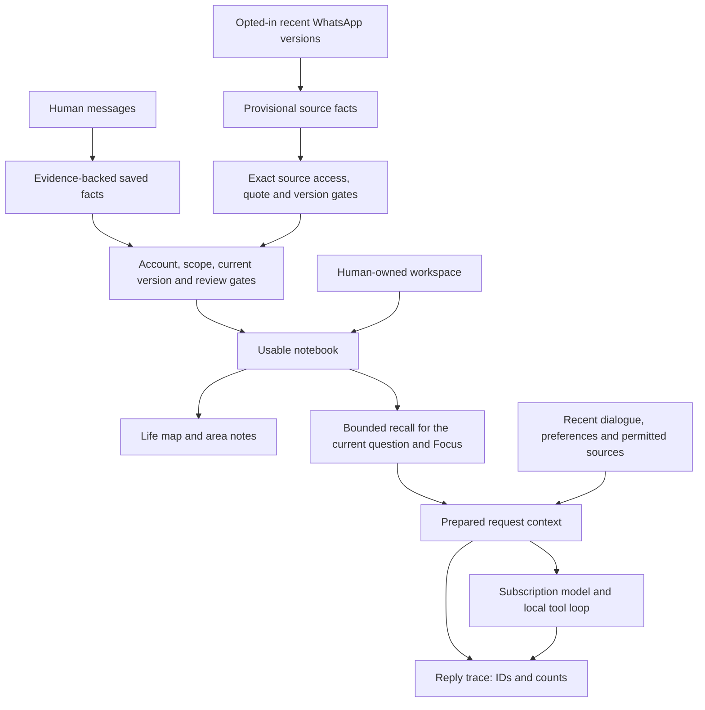

# Memory and context in 3PO

The PA has a saved notebook and builds a smaller working context for each request. The Life map shows the usable notebook and your workspace. It does not show every cached message, saved transcript or input used by an AI request.

## Inspect it in the app

Open **PA menu → Memory**, **Life map → Memory & context → Inspect memory & context**, or **Settings → Memory → Inspect saved memory and recall**. Opening, searching or previewing recall makes no AI request and does not refresh sources.

- **Overview** explains the layers, counts saved records/current versions/available records, lists exclusion reasons and previews saved-fact selection for a question and Focus.
- **Facts** shows original facts, certainty, evidence and dates. View version history, confirm, edit, organise, resolve or forget a fact. These are explicit local operations; resolving memory does not complete a Reminder.
- **Life areas** groups currently usable facts and workspace anchors. Select an area to inspect its facts and recorded relationships. Area branches navigate the notebook; they are not inferred relationship claims.
- **Controls** contains the memory-use, human-conversation learning, optional question and existing-fact organisation controls. WhatsApp learning remains a separate opt-in in its source controls.

New foreground replies offer **Context details**. It records the IDs of the initial saved-fact selection, facts in the separate notebook input, additional memory-tool reads, bounded dialogue/excerpt counts, workspace IDs, model, captured Focus and whether a cached source snapshot was prepared. Tool names mean attempted tools; verified changes are shown in their existing receipts. This trace explains prepared inputs, not model attention or reasoning. Older replies have no invented trace.

The trace stores no extra copy of memory prose, source bodies, prompts, tool arguments, credentials or model reasoning. Inspecting a saved ID shows the fact as it exists now: it may have been corrected, become unavailable or been forgotten since that reply. It is not a historical plaintext prompt export or an exhaustive tool-result audit.

## The structure

| Layer | Durable record | Authority and purpose |
| --- | --- | --- |
| Human conversation | Account-owned messages with original IDs, optional legacy scope, Focus and interview tags | Current human intent can authorise a supported change. Historical dialogue alone does not authorise a new change. |
| Human memory | `PAMemory`: preference, context or commitment; stated/inferred, stable/situational, evidence, dates | Useful personal knowledge. Confirmed/stable stated facts persist; provisional interpretations remain distinguishable. |
| Source memory | The same `PAMemory` type with exact source identity/version/quote and optional supporting evidence/report state | Attributed source interpretation, separately permission-gated; never human assertion or action authority. |
| Belief history | `supersedes` / `supersededBy` between unchanged record identities | Current belief is used; old wording/evidence stays inspectable. Restore makes a new current version. |
| Organisation | Optional areas and typed endpoints referring to the fact's existing connections | Navigation and recall metadata. Manual organisation is pinned; organisation cannot invent a fact. |
| Workspace | `LifeWorkspaceStore` human-owned projects, headings, notes, tasks and exact source pointers | Editable durable content, with hierarchy/order/tombstones. Mentioning a project is not permission to create one. |
| Notebook / map | `LifeNotebook` plus canonical workspace-anchor projection | Derived usable facts and exact workspace identities. It is rebuilt locally, not another independently editable memory database. |
| Working context | Request-local selection, notebook notes, dialogue, preferences, cached snapshot and tool results | Bounded information for one request; ownership is captured before inference and checked before outputs/actions. |
| Reply trace | Optional `AssistantTurn.contextCapture` | IDs/counts for inspection; separate from source-dependency guards and action receipts. |

## Saved, current, available and selected

**Saved** includes old versions, resolved commitments, facts needing review and source-derived records outside current access. **Current** means no newer version supersedes it; that alone does not make it usable.

**Available** additionally requires the active registration, permitted scope, no resolution/invalidation, any required provisional review, and current source access for every retained quote. Inferred/situational context needs review after 90 days. Stable directly stated human facts are retained. Source cache loss is unavailability, not evidence of deletion or completion. Turning memory use off selects no saved facts; the records and their saved states remain inspectable.

**Selected** is the smaller set supplied for a particular question. The local ranker considers word overlap, recorded connections within two hops, Focus, confirmed preferences, certainty/kind/scope and review date. It keeps a small core of confirmed preferences and caps this input at 40 records and 20,000 UTF-8 bytes. It does not run an AI or embeddings call. Its explanations come from the same ranking pass as the production selection.

The notebook is a second bounded input: up to four areas with six facts each, plus up to twelve workspace anchors, within 8,000 bytes. The universal self node is not a traversal bridge to every area. Focus is a relevance preference: it can draw on other relevant areas and never grants source access. In a Focus conversation this account's usable earlier-topic memories are available; legacy queued/thread work retains its captured scope. The local preview is saved-fact selection only; Context details separately exposes notebook IDs and later memory reads.

Recent dialogue is also bounded: up to twenty eligible completed turns and 24,000 bytes, with human dialogue prioritised over background deliveries. Earlier turns may be marked excerpts. Full visible history is kept separately. Source-dependent old assistant prose can be omitted from future AI history when its dependencies are no longer usable, without deleting the visible transcript.

## Evidence, corrections and source changes

Human memory points to the original statement. Source memory points to an exact account/container/message/linked identity, literal quote, content revision, message date and observation time. Up to three quoted versions support a source claim. Same-chat newer source updates can replace a provisional belief while retaining earlier evidence. A human-confirmed/human-origin fact is not silently overwritten by a source report.

Source states such as proposed, accepted, changed, cancelled or completed are attributed reports. A proposal is not automatically the user's obligation. A cancellation is not automatically a Reminder deletion. Calendar/Reminders tools still require understood current human intent, fresh exact record identities and verified native readback.

Human corrections atomically link the old and new beliefs. Current-belief Forget removes its lineage and suppresses its original learning evidence. Forgetting one explicitly selected historical version has narrower semantics. Dependent source quotations become unavailable; local Undo preserves independent Forget owners. The inspector follows a lineage in either direction without changing those deletion rules.

## Source coverage and background work

Source collection is separate from interpretation. Normal Refresh, Mail arrivals, WhatsApp reception and opening an inspector make no AI call. Automatic learning checks eligible deltas only through the idle scheduler. Conversation learning, optional WhatsApp learning and existing-fact organisation share their existing automatic budget/cooldown; failed or interrupted work remains paused for explicit continuation.

WhatsApp source learning currently assesses up to eight recent waiting versions with bounded neighbouring/saved evidence. Exact assessment receipts and pending references distinguish received, assessed and unavailable content. It does not sweep history or learn from every conversation. Mail is read-only through the native bridge; Cambridge Graph permissions are unavailable. Mail/Calendar/Reminders permanent source-memory learning is not implemented by this inspector.

## Code and storage ownership

- `PAMemory.swift` defines facts, evidence and recall ranking. `PAMemoryStore.swift` owns the `paMemory` SwiftData cache envelope, correction/Forget transactions, permitted projection and notebook selection.
- `LifeNotebook.swift` builds area/entity/link notes; `LifeCanonicalNotebook.swift` projects durable workspace anchors. Original facts remain authoritative.
- `MemoryInspection.swift` explains the same recall gates. `MemoryInspectionView.swift` renders local inspection. It has no persistence, source refresh or inference path.
- `AssistantService.swift` assembles one initial selection and notebook context for both the request and its trace. `Conversations.swift` keeps the optional trace on the existing turn in `assistantConversations`.
- `PAToolSession.swift` records successful memory-read IDs separately from issued IDs. Issued IDs still control mutation safety; the trace grants no authority.
- Native source adapters, source learning, usage accounting, brief/proactive services and the queued-work store retain their independent responsibilities.

The SwiftData cache is local Application Support data, excluded from Git. ChatGPT registrations live in Keychain; WhatsApp auth/message/name stores are encrypted with a Keychain-held key. Derived memory quotes and other SwiftData context are not all encrypted today; extending encryption and measuring deletion/retention coverage remain planned work. This is a personal development app, not a claim of a complete encrypted vault.

## What still needs work

The existing structure supports an inspectable, evidence-backed notebook. It does not yet provide reliable global aliases, semantic consolidation, a complete temporal commitment episode across email and WhatsApp, or a persistent shared Tasks/brief lifecycle for source-belief changes. Broader source learning, sustained multi-turn quality evaluation, global background coordination and checkpointed delegated artifacts remain open. Offline inference is later. See [Next improvements](NEXT_IMPROVEMENTS.md), [Architecture review](PA_ARCHITECTURE_REVIEW.md) and [STATUS](../STATUS.md) for delivery and live acceptance boundaries.

GPT-6 Luna exists in OpenAI's current [model documentation](https://developers.openai.com/api/docs/models/gpt-6-luna). Availability for this app is determined by the selected account's [subscription model catalog](https://developers.openai.com/siwc/token-sharing-open-source/models-and-inference), not by the Codex picker or API pricing page. **Settings → Connections → Refresh models · no AI** refreshes that catalog without changing the selected model or making inference. The separate access check explicitly spends one source-free request.
