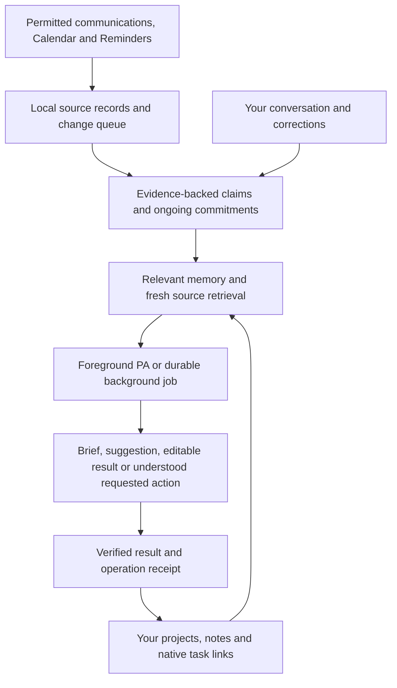

# Mission Control as a personal assistant and second brain

Architecture review and recommended delivery sequence, 6 October 2026.

This is a dated architecture assessment, not the current delivery summary. Later 7–12 October changes include selective Mail lanes, source-aware advice, Review inbox, targeted memory relevance, Space/Task-only Projects, scheduled heartbeat recovery and separated assistant/learning/heartbeat runtimes with atomic keyed storage. Read [STATUS](../STATUS.md), [VALIDATION](../VALIDATION.md) and [Next improvements](NEXT_IMPROVEMENTS.md) before applying its older observations or proposed sequence. Broader shared episodes, semantic recall and offline inference remain future work.

Mission Control should become a personal workspace whose assistant understands ongoing work, follows communications, and produces useful results while you are elsewhere. The native dashboard, project space and PA should share the same records. Your knowledge should remain usable when the inference provider changes. Offline inference is a later goal, not a prerequisite for the next delivery.

The recommendation is to evolve the existing native app around evidence, changing situations and durable jobs. Its current source readers, memory history, workspace identities and verified action tools are valuable foundations. The biggest missing connection is a shared account of ongoing commitments across sources, with measured collection and assessment coverage.

This document distinguishes the recommended architecture from delivered increments. The 6 October follow-up delivers clearer Settings/Help, account-scoped usage tracking and honest, fair WhatsApp learning progress; the wider commitment/retrieval/job design remains planned. New integrations, permissions and automatic-write policies below are recommendations. Existing approved controls and validation boundaries remain authoritative. [How it works](HOW_IT_WORKS.md) describes current behaviour; [STATUS](../STATUS.md) records historical tests and live acceptance.

## What the current implementation establishes

The review inspected the current source and recent delivery records, without opening personal mail, chats or memory and without running inference.

- Calendar and Reminders use native identity, revision and readback checks. The foreground tool loop executes completed responses, retains operation receipts and supports Stop. The latest implementation removes foreground work-count caps; automatic jobs retain independent allowances.
- Outlook mail currently reaches the app through Apple Mail's local scripting bridge. Recent identity-overlap reconciliation, a retained cache and rotating audits improve late-arrival handling. This remains bounded local polling, with incomplete custom-folder/history coverage and outstanding sustained move/delete/sleep acceptance.
- WhatsApp uses the separate encrypted read-only Baileys helper. Foreground access, suggestions and context learning have distinct controls. Received text is partial linked-device history; contact labels do not merge message identities.
- Memories preserve evidence, origin, certainty, scope and correction history. Recall uses word overlap and two entity hops, with bounded notebook context. A general reusable person/alias registry and semantic retrieval are not implemented.
- The creator follow-up adds a local [memory/context inspector](MEMORY_AND_CONTEXT.md): saved/current/available distinctions, evidence dates/lineage and the production recall preview. New foreground turns retain prepared memory/notebook IDs, dialogue counts and attempted tool names on the existing transcript record. This is input metadata, not model attention or an exhaustive source/action audit; inspection makes no AI request.
- Optional WhatsApp memory learning reads at most eight recent messages per pass. It shares four automatic passes per day with conversation learning and organisation. The follow-up retains pending opaque message-version references across passes, shares batches fairly between selected chats, and marks only a successfully assessed batch as assessed. The available learning window covers at most 2,000 cached text records from the last 48 hours; inference still takes at most eight. Legacy cursors are retained as baseline-only, without replaying history or claiming they were assessed. Expired/removed pending versions are disclosed. Separately, proactive comparison still uses its own bounded WhatsApp sample and is not an exhaustive review queue.
- The configurable heartbeat has a persisted request allowance across its email/proactive work. The wider background services still have separate state and scheduling guards. Pending heartbeat flags are not a durable per-message understanding queue. A partial native-source check can defer the entire heartbeat assessment.
- Queued chat requests persist prompts, state, focus and bounded results. Interrupted work requires explicit continuation. This is useful delegation, but not yet a checkpointed job with durable intermediate artifacts and step-specific recovery.
- LifeWorkspace already provides durable projects, tasks, headings, relationships, ordering and recoverable deletion. Linked native items keep their own truth: completing a local task currently does not complete its linked Reminder.
- Inference and many ownership checks refer directly to the active ChatGPT registration. A local model will need a stable local profile identity as well as a provider adapter; replacing one HTTP call alone will not enable offline operation.

Relevant implementation: [source learner](../MissionControl/SourceContextLearningService.swift), [source rules](../MissionControl/SourceContextLearning.swift), [memory retrieval](../MissionControl/PAMemory.swift), [notebook identities](../MissionControl/LifeNotebook.swift), [canonical workspace projection](../MissionControl/LifeCanonicalNotebook.swift), [heartbeat](../MissionControl/HeartbeatService.swift), [email assessment](../MissionControl/EmailSummaryService.swift), [request queue](../MissionControl/PARequestQueue.swift), [workspace](../MissionControl/LifeWorkspace.swift), [subscription connection](../MissionControl/ChatGPTConnection.swift).

These observations support a direction, not a claim that the app's personal recall or monitoring is already optimal. Historical fictional checks and individual live recoveries do not establish sustained understanding.

## A shared pipeline

Source collection runs without AI. The queue records new or changed material before assessment. Reasoning jobs read the relevant permitted evidence and workspace state, then publish a result or use the existing authorised tools. Briefs, Tasks and chat become different views over this shared understanding rather than independent interpretations of the same inbox.

Keep the app a modular local application. Versioned domain stores can build on existing SwiftData persistence; separate services own source access, evidence, memory, commitments, retrieval, jobs, inference and native actions. DashboardModel should coordinate presentation rather than accumulate all scheduling and reasoning policy. Add a rebuildable search index when needed, without editing SwiftData's internal database or introducing a hosted database. A standalone graph server or a general agent framework is unnecessary for the initial stages.

## Reliable communications come first

Each adapter should expose original account/item identity, container, participants, event time, local observation time, content revision, source links and explicit coverage. Record additions, edits, removals and access changes separately. Missing cache data means unavailable evidence; only an authoritative provider result establishes deletion.

Persist ingestion progress independently from assessment progress. Distinguish collected, queued, assessed, intentionally ignored, baseline-only, unavailable and expired-unassessed. Saving a batch and its cursor must be atomic or safely idempotent. A small AI allowance should delay understanding visibly rather than silently advance an assessment cursor. Bound retention and payload size, but keep pending work inside the disclosed retention policy; if it ages out, record a coverage gap.

Group message changes into conversation episodes with surrounding context. Eight messages from a busy group can contain a proposal, acceptance and cancellation; isolated latest-message extraction can lose their meaning. Use fair queues across accounts/chats so one noisy source does not consume all attention. A cheap triage stage may prioritise likely relevance, but its exclusions and missed important cases must be measured. Importance should depend on responsibility, deadlines, stated goals and changed commitments, not sender keywords alone.

For this account, retain the Apple Mail adapter. The user confirmed Cambridge tenant permissions block the Graph route; no registration, consent workaround or migration is needed. Improve the existing identity-overlap reconciliation, folder audits and explicit partial coverage instead of making PA understanding depend on an unavailable integration. A supported server adapter can remain an optional future alternative for an account where it is permitted. Graph's per-folder deltas and immutable IDs are useful adapter requirements, not a reason to reset this mailbox's cache or historical assessment start. [Microsoft delta documentation](https://learn.microsoft.com/en-us/graph/delta-query-messages), [immutable identifiers](https://learn.microsoft.com/en-us/graph/outlook-immutable-id).

Keep the WhatsApp helper replaceable behind the same adapter contract. Track disconnect intervals, reconnect state, linked identity and known text-history limits. Media, voice notes and attachments require separate ingestion work; cached text cannot stand in for them. Baileys is an unofficial WhatsApp Web integration and publishes breaking-change notices, so connection health and partial coverage must remain visible. [Baileys project](https://github.com/WhiskeySockets/Baileys).

Continue using EventKit for native Calendar/Reminders truth and writes. A future mail adapter should not create a second calendar-writing system. Reconcile actual supplied records after change notifications; unrelated notifications must not invalidate completed reasoning.

## Memory should describe what is true, when, and why

Use several distinct record types, exposed through one retrieval interface:

| Record | Purpose | Example |
| --- | --- | --- |
| Source evidence | What a permitted source actually said | A particular message version and quotation |
| Lasting personal knowledge | Stable preferences, relationships and background | A directly stated planning preference |
| Temporary situation or claim | A dated interpretation of current circumstances | A sender says a report deadline changed |
| Open commitment | Responsibility and its current lifecycle | A report is pending, blocked, submitted or cancelled |
| Human workspace content | Projects, notes and actual work structure | A study project with resources and milestones |
| Job and action history | Delegated work, results and verified changes | A saved analysis or native operation receipt |

Do not save every message as a permanent fact. Learn a lasting preference or relationship when its evidence supports that conclusion; represent scheduling updates and pending work as situations/commitments. Store generated area summaries as replaceable projections with evidence links, not independent authoritative biographies. Keep personal knowledge external to model weights so corrections, forgetting and provider changes remain practical.

Extend existing records additively with canonical subject/project identity, field or relationship, original evidence IDs/revisions, attribution, certainty category, source event time, observed time, effective interval and supersession links. A model's numerical confidence is not calibrated probability; use understandable categories and test them. “Someone proposed Monday” and “the meeting is confirmed for Monday” are different claims.

Corrections and newer evidence need field-specific rules. Human corrections govern personal beliefs; a new authoritative schedule message may show that an earlier confirmed plan needs revision. Do not apply a universal newest-text-wins rule or freeze every old human statement forever. Retain conflicting claims, their dates and an uncertainty state until the conflict can be resolved. Passing a deadline is not proof of completion.

Build a reusable entity registry using stable local identities and supported aliases. Bind source participants only through reliable identifiers or an explicit human match. Two people called Alex remain separate; two similar project names become possible matches rather than an automatic merge. The existing workspace IDs and canonical projection should seed this registry.

A source change or access revocation should invalidate dependent claims, summaries, embeddings, active suggestions and future inference context. A missing cached source should label a belief unavailable instead of establishing deletion. Preserve historical transcript text and verified operation receipts, while withholding disallowed evidence from new requests. Forgetting must remove derived retrieval material and prevent the same old evidence recreating the belief; a genuinely new human statement can establish new knowledge.

Derived WhatsApp quotations currently enter the ordinary local memory store, beyond the helper's encrypted cache. Extend encryption-at-rest deliberately to new source-derived stores/indexes and provide understandable retention/export/forget controls. Local storage does not by itself mean cloud inference has never seen the selected content. A provider selection should explain its data destination.

## Retrieval makes that memory useful

Use a hybrid local retrieval pipeline: apply profile/source permission and current-version filters first; resolve exact entities and dates; combine full-text relevance, optional local semantic similarity and bounded relationship expansion; then rank by relevance, evidence, current validity and responsibility. Preserve the small preference core and Focus as a relevance hint rather than an access grant.

Full-text indexing is a practical next step for permitted notes and message episodes. SQLite FTS5 supplies ranked text matching, including BM25. Any index must be separately owned/rebuildable and carry profile, source and content-version metadata. [SQLite FTS5](https://sqlite.org/fts5.html).

Evaluate semantic search on paraphrase failures, such as a question about “exam preparation” missing a relevant “revision plan”. Add a local embedding model if it improves the measured task; do not require paid embeddings or a dedicated vector service. For modest personal datasets, a simple bounded local similarity index may be sufficient. Combining exact, text, vector and graph candidates is a recommendation to test against the current word-overlap baseline, not a proven best configuration.

Keep graph navigation useful for relationships and inspection. A 3D graph is an optional view over the same identities, not an intelligence milestone. A bigger graph or longer prompt cannot establish better reasoning without outcome tests.

## Follow commitments through their lifecycle

Introduce a shared commitment store. Each commitment has an owner/responsibility, relevant people/project, explicit date or unknown timing, current status, evidence history, native bindings and last verified state. Distinguish proposals, confirmed commitments, open work, waiting, completed and cancelled. A suggestion dismissal is presentation feedback, not task completion.

Compare commitments with fresh permitted Calendar/Reminders and workspace bindings. Match candidates by identity, participants, timing and provenance; equal titles are insufficient. Prefer evidence-linked proposals such as “This deadline moved; your linked calendar entry still has Friday” or “This request has no linked reminder in the lists I checked”. State the actual checked coverage.

Reasoning should separate extraction from follow-through: what happened, whether it is your responsibility, what is already represented, what changed, and what useful next step remains. Quiet reminders should reflect urgency and material changes. Deduplicate by commitment identity/version, share suppression across chat/brief/Tasks, and keep notification delivery IDs separate from morning records and action receipts.

Background work may analyse, organise supported life anchors, prepare drafts and suggest updates under current controls. Understood human requests and accepted concrete proposals continue through existing verified tools. Automatic calendar maintenance would require a later explicit, narrow standing policy defining sources, destinations and allowed changes; evidence in a communication does not grant that policy. This review does not introduce it, require a new confirmation template for normal requests, or weaken native revisions/readback.

## Delegate jobs that produce something

Extend the existing request queue into a durable job record with a human goal, completion criteria, captured profile/focus, permitted tools/sources, input dependencies, step checkpoints, editable artifacts, operation receipts and a clear final handoff. Useful examples are producing a weekly study plan, comparing a resource pack, reconciling upcoming commitments or preparing a project progress review. Research beyond existing sources needs a separately delivered read-only web/document capability.

Use one serial worker initially. Keep planning, reading, drafting and verification as explicit stages; add parallel workers only if a measured task justifies their complexity. The result should include what was produced, which evidence supports it, what remains uncertain and any decision needed. Store a draft artifact rather than relying on an easily lost streamed reply or silently replacing human-authored notes.

A single background coordinator should own priority, a visible combined automatic request allowance and recent foreground activity. Prioritise active human work and due morning briefs, then relevant changed commitments; reserve room for learning/maintenance so busy inboxes cannot starve them. Preserve existing controls and quotas during incremental migration. Subscription failures pause AI; collection and pending records continue. Foreground explicitly delegated work retains the latest no-count-cap policy, Stop and per-request/payload bounds.

Recovery must distinguish checkpointed read/compute/draft work from external mutations. Initially preserve today's explicit Continue behaviour. A later user-enabled recovery policy could resume safe read-only stages after source/permission validation. Never replay an uncertain Calendar/Reminders save; reconcile its persistent receipt and exact native state first. Saved task objectives and operational policy are authority; imported source text and retrieved beliefs are not.

Current local background work requires the app running on an awake Mac. Offline work can use saved permitted context, but cannot receive new WhatsApp/Outlook messages. Running while the UI is quit would need a separately designed and enabled local worker with verified permissions and one storage writer. Running while the Mac is asleep would require another awake device/service. Do not infer either capability from the word “background”.

## A project space backed by the same knowledge

The Notion resemblance is useful: pages, flexible views, notes, project hierarchies and source-linked resources. Build on existing LifeWorkspace instead of keeping a second isolated project database. An Engineering dashboard could show module resources, pending Reminders, upcoming deadlines, project milestones and grounded progress, all through shared identities.

Since the user wants to-do lists through Reminders, recommend Reminders as the authoritative state for executable personal tasks. Project records organise the work and link exact native task IDs. Make the binding explicit: an unbound local checklist remains local; a bound task reads completion/due state from Reminders and changes it only through the native adapter. This is a proposed improvement to today's independent source links, not existing synchronisation. Never mirror by title or infer progress/mastery from message volume.

Add notes/resources, attachments, richer progress views and custom lightweight widgets as separate modules once the shared data contracts are sound. Weather remains a source of short-lived contextual information. News and broader media can later implement source/document adapters with relevant retention and extraction rules. They need not change memory ownership or the job runner. Visual refinement can then focus on a consistent workspace rather than expose internal pipeline stages.

## Later local-model work

Offline inference is deferred by the user. Avoid a provider/profile migration in the current increment; keep these seams as a future design requirement. When that work begins, introduce a stable local profile identity distinct from an inference account. Existing ChatGPT registrations should map explicitly to their current records; migration must preserve original IDs, transcripts, scopes, drafts, source permissions and receipts. Do not combine accounts automatically. Offline/local mode must not require subscription sign-in or inherit another profile's source access.

Use a provider-neutral inference contract for input context, capabilities, completed text/tool proposals, streaming progress, cancellation, usage/failure and opaque provider continuation state. Keep tool execution and authority checks in the app. Encrypted subscription reasoning replay belongs to that provider adapter and must not become a format every model is expected to reproduce.

Retain the documented subscription OAuth Responses integration, eligibility checks and no-billing-fallback rule. Official documentation supports streamed Responses with an authorised ChatGPT-plan token; model availability still depends on the selected account. An adapter abstraction does not grant an entitlement or require migrating to a hosted agent platform. [Official OpenAI models and inference documentation](https://developers.openai.com/siwc/token-sharing-open-source/models-and-inference).

For Apple silicon, evaluate MLX Swift LM as a candidate local inference runtime, with locally available weights/tokenizer and networking disabled in offline tests. Its project includes language, vision and embedding components; version/SDK compatibility must be checked before adoption. A llama.cpp adapter is an alternative to compare, not a second required runtime. No model download or runtime installation is part of this review. [MLX Swift LM](https://github.com/ml-explore/mlx-swift-lm).

Choose the model only after measuring the Mac's available memory, task accuracy, context size, latency and energy use. Start with local retrieval and low-risk extraction/drafting; enable action-capable reasoning only after the same intent, chronology, tool and failure evaluations pass. A small offline model can use the whole permitted knowledge store through retrieval without fitting that store into its prompt. Offline answers must state source freshness, and local mode must never silently send context to a cloud provider.

## Prove helpfulness, not just plumbing

Create a repeatable fictional multi-day scenario suite through the real production pipeline: ingest messages, resolve identities, extract claims, retrieve evidence, propose work, apply understood human requests and reconcile verified results. Test new dates, conflicting messages, same-name contacts, cross-source duplicates, cancelled plans, quoted instructions, denied access, model failures, sleep/relaunch, quota rollover, retained pending work and more than one busy chat.

Measure source collection coverage separately from assessment coverage; important-item recall separately from interruption precision; and retrieval success separately from final reasoning accuracy. Add stale-fact, attribution, correction/forgetting, unsupported-action and duplicate-operation checks. A fluent wrong answer should fail even when its JSON is valid. Every proposed commitment needs supporting evidence; the hard identity, access, authority and duplicate checks must pass before native action tests.

LongMemEval provides a useful evaluation taxonomy: extraction, reasoning across sessions, temporal reasoning, knowledge updates and abstaining when information is unavailable. Use those categories alongside Mission Control's own source/action scenarios; it is a research benchmark, not proof that a particular memory product or graph is best. [LongMemEval paper](https://arxiv.org/abs/2410.10813).

After fictional evaluation, run a user-enabled personal observation period for the new pipeline, with source-linked proposed results and the existing approved action behaviour retained. Inspect missed important items and noisy suggestions locally; record coverage/latency/usefulness rather than private messages in Git. Model/provider comparisons should use the same held-out scenarios, not one impressive demonstration or a larger memory count.

## What recent research changes about this recommendation

The evidence does not establish one universally correct personal-memory stack. The practical recommendation is external, inspectable evidence plus chronological context, current claims and evaluated retrieval. Preserve raw evidence so a summary can be corrected or rebuilt. A graph, embeddings or a larger prompt is a candidate mechanism, not proof of better help.

- **LongMemEval (ICLR 2025)** tests extraction, cross-session reasoning, chronology, updates and abstention. Its findings motivate keeping conversational context and time-aware retrieval. Mission Control should test those abilities through its own source and native-action pipeline. [Paper](https://arxiv.org/abs/2410.10813).
- **LongMemEval-V2 (May 2026)** extends memory evaluation to web-agent trajectories, including changing state, workflows and false-premise handling. Its richer observation/event/strategy representations support preserving more than isolated facts, but its browser tasks are different from this personal assistant. [Paper](https://arxiv.org/abs/2605.12493).
- **Memory in the Age of AI Agents (revised January 2026)** distinguishes factual, experiential and working memory and separates formation, evolution and retrieval. This supports separate source records, current beliefs and job context, while warning that evaluation is fragmented. [Survey](https://arxiv.org/abs/2512.13564).
- **RecMem (ACL 2026 Findings, May)** studies consolidating recurring information rather than invoking an LLM for every incoming interaction. Its reported savings support measuring selective consolidation, not adopting its recurrence filter for urgent one-off deadlines. Source reception should remain no-AI; urgent triage and lasting memory have different purposes. [Paper](https://arxiv.org/abs/2605.16045).
- **ScrubJay-MEM (August 2026 preprint)** studies content-dependent validity and temporal retrieval. The authors disclose narrower gains with stronger models and worse consolidation results in some tasks. Distinguish lasting preferences from temporary plans, retain dates and uncertainty, and test freshness rules rather than copying a universal decay constant. [Paper](https://arxiv.org/abs/2608.04746).
- **Zep / Mem0 (2025)** explore temporal graphs and extracted/consolidated memory. They are useful implementation references; author-reported benchmarks do not establish that either product is the best fit here or justify a hosted service. [Zep](https://arxiv.org/abs/2501.13956), [Mem0](https://arxiv.org/abs/2504.19413).

For communication ingestion, Baileys documents arrays of message upserts plus separate update/delete events. The helper already processes those event types and has fictional multi-message/edit/delete tests. This does not prove complete live history, reconnect replay or all media coverage. [Event documentation](https://github.com/WhiskeySockets/baileys.wiki-site/blob/main/docs/socket/receiving-updates.md).

For usage, count actual local request attempts and validated completed-response token metadata. A background review may make several requests. Model token counts are not a remaining subscription percentage; missing counts stay unknown. The documented subscription flow directs users to ChatGPT Usage and identifies app-sharing limit failures; the app should preserve sources/results and pause, without inventing a quota/reset or purchasing credits. [Official subscription guide](https://developers.openai.com/cookbook/articles/sign-in-with-chatgpt), [recovery documentation](https://developers.openai.com/siwc/token-sharing-open-source/errors-and-recovery), [token accounting](https://developers.openai.com/api/docs/guides/token-counting).

## Delivered first increment

Settings now has General, Connections, Assistant, Background, Memory, Usage and Help sections. Background review distinguishes interval, delivered-message limit and its advanced communication-call allowance. Help explains context destination, optional source uses, native truth, selective learning, quotas and interruption recovery. Usage records account-scoped model/category/outcome/count metadata for at most 30 days or 5,000 calls; it never stores prompts, source content, credentials or estimated plan percentages.

Optional WhatsApp learning persists waiting version references independently of its eight-target inference batch. Fair chat allocation and oldest-first selection within a chat prevent one busy source from taking every slot. Only completed, validated batches advance assessment. Legacy cursors remain baseline-only without historical replay. Source expiry/cache loss stays visible, and off/on source-context or learning changes invalidate captured output. Input is grouped chronologically by opaque conversation identity. Same-conversation source-belief updates now preserve version history with up to three exact evidence spans and typed attributed states; surrounding/saved evidence is bounded and context-only. Human memories stay protected. Facts and opaque assessment receipts commit atomically, allowing cursor recovery without a second extraction. Full commitment episodes, cross-source identity and persistent Tasks/brief lifecycle dependencies remain next work; this increment does not establish exhaustive contradiction detection.

These deterministic coverage and storage checks establish progress accounting and authority preservation, not final recall quality. The next architecture unit is a fictional multi-day email/WhatsApp/Reminders commitment timeline through real ingestion and retrieval, followed by the smallest schema/retrieval changes its failures justify. Global background scheduling, degraded-source independence, full episode evidence, aliases, evaluated semantic retrieval and checkpointed job artifacts remain open.

## Recommended implementation order

1. **Coverage and evaluation baseline.** Add a collection/assessment status view and realistic multi-day fixtures. Characterise current Mail/WhatsApp omissions, fairness and sleep/relaunch recovery. Keep existing source choices and monitoring checkpoints. Retain Apple Mail because Cambridge denies Graph access; do not retry tenant consent as part of this work.
2. **Durable source changes and common scheduling.** Add a bounded persisted change queue with honest baseline/skip states, per-source fairness, dependency-based jobs and a coordinator above the existing services. Preserve current automatic quotas until replacement controls are deliberately introduced. Improve the existing Apple Mail lane and partial-source degradation; a Graph reader is outside the current account strategy.
3. **Temporal claims, canonical identities and commitments.** Extend current memory/workspace records additively; support multi-source evidence, aliases, lifecycle updates and artifact invalidation. Feed the same commitment records to Tasks, briefs and PA retrieval. Expand separately authorised source learning beyond the initial WhatsApp lane.
4. **Measured retrieval and durable delegated outputs.** Add permitted full-text episode search, evaluated local semantic retrieval where needed, checkpointed jobs and editable artifacts. Improve ranking and bound-task Reminders projections. Record the provider/local-profile seam for the later offline milestone without migrating current ownership now.
5. **Offline model pilot and focused workspace polish.** Test local inference against the same suite, preserve current subscription mode and expose explicit destination/freshness. Refine the Engineering dashboard and reusable project/resource views. Add news, broader media and optional 3D only as independently useful later modules.

Each increment needs focused deterministic checks, actual model quality evidence where relevant, a native build for runtime changes and separately recorded installation/live acceptance. Preserve all current IDs, personal data, layouts, transcripts, receipts and correction history. New stores/indexes need versioning and recoverable migration; old source history is not automatically reprocessed.

The first concrete development unit should be coverage plus a fictional cross-source commitment timeline. It will show whether the current PA notices, remembers and updates an important situation before increasing automatic processing. A realistic example is a report deadline stated in email, changed in a later conversation, linked to an existing calendar item and finally completed by the user. Success means one coherent current commitment, evidence for each change, one useful correction proposal, and no duplicated or unauthorised native action.

## 7 October delivery update

The earlier delivered-message setting is superseded: useful communication outputs have no daily count cap and persist in Review inbox without new normal-chat delivery. Review frequency and the advanced request allowance remain distinct. Inferred exact-source/native date-change proposals can be reviewed and approved without a manual memory identity connection. Persistent quiet-result/source-version progress replaces morning-brief mentions as comparison suppression. Source-dependent advice and human-reviewed plan groups are implemented, with their exact validation limits in STATUS; global job coordination, complete semantic episodes and sustained real-source scheduling remain upcoming.
